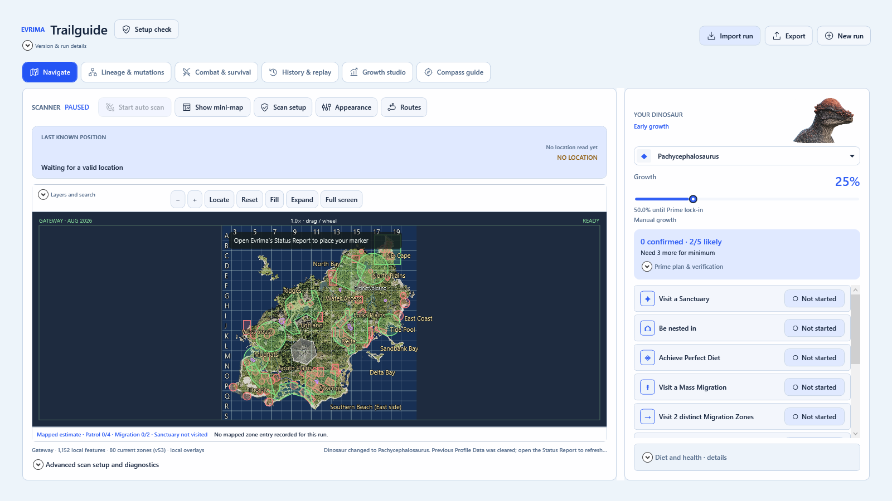
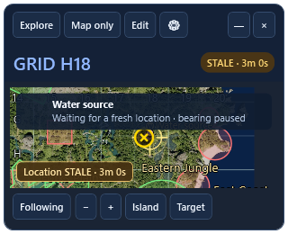
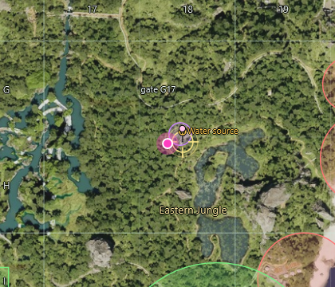
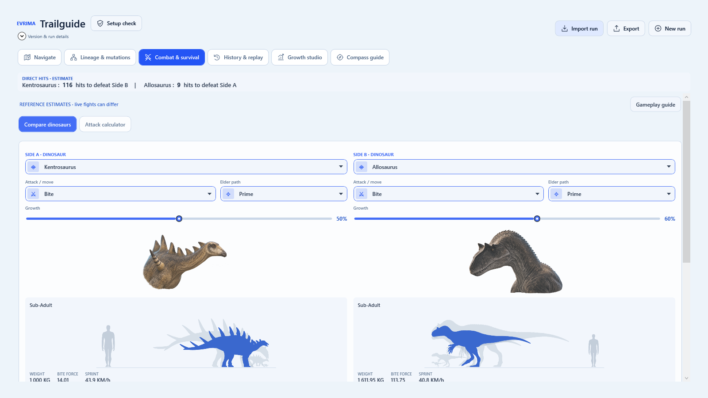
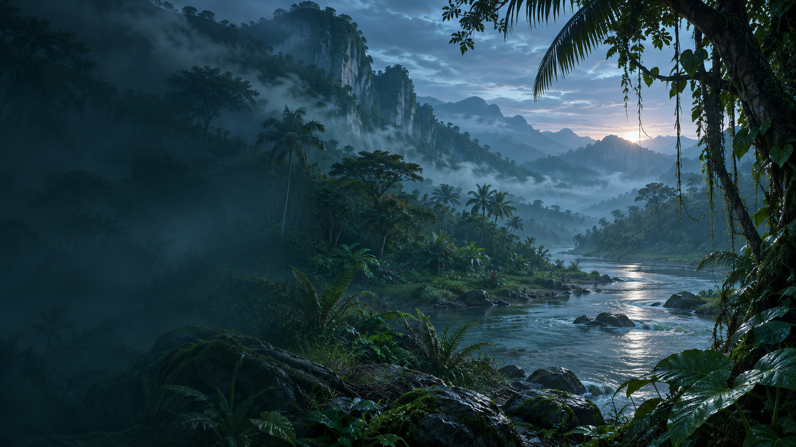

  

  
  
  

**Make the island feel familiar.** Evrima Trailguide brings your map, Prime checklist, dinosaur references and run history into one Windows companion. Mark your next stop, compare a matchup, and take a compact mini-map back into the game.

Free to use. No account. Your screen readings and saved runs stay on your PC.

## A clearer view of your next run

| Find your way | Grow with a plan | Know your matchup |
| --- | --- | --- |
| Follow accepted location readings, place personal pins and connect the stops that matter to you. | Keep attempted and confirmed Prime objectives distinct, with your dinosaur and growth in view. | Compare species, attacks and growth, with separate direct-hit and bleed estimates. |

The **Glacier** appearance pairs ice-white panels with cobalt controls. Prefer a darker cockpit? Choose another theme in **Appearance**; existing users keep their selected look.

## Your map, your way

| A compact companion | Just the essentials |
| --- | --- |
|  |  |

- **Keep the map close:** compact, exploration and passive map-only views, with follow/resume-follow controls.
- **Make it readable:** terrain opacity, labels, marker size and colour, breadcrumb styling and map layers.
- **Plan the route:** named waypoints, navigation targets, ordered stops and shareable route records.
- **Keep your setup:** save up to eight personal mini-map layouts.

Trailguide reads **your own visible Status Report coordinates**. Open that screen to refresh; when the numbers are hidden, the map retains the last accepted fix and shows its age. It does not reveal other players or read game memory. Borderless/windowed play is intended.

## See the dinosaur. Explore the numbers.

Choose both dinosaurs and their moves, then adjust growth to see the reference stats and estimates change together. Use separate mutation scenarios and calculation details when you want a closer look.

These are **reference comparisons**, not guaranteed fight outcomes. Timing, positioning and unmodelled mechanics still matter.

<strong>Meet the 22 dinosaur portraits</strong>

AI-assisted illustrations based on Evrima game-model references. Measured silhouettes remain the growth and size reference.

## Keep more than a location

| Explore | Remember |
| --- | --- |
| **Growth Studio** — compare stages and reference stats. | **History & replay** — revisit archived lives, routes and events. |
| **Compass guide** — recognize resource, direction and zone symbols. | **Lineage & mutations** — record generations and your chosen mutations. |
| **Expedition planner** — organize food references, recovery plans and field notes. | **Profile backups** — keep a recovery copy of settings and recorded runs. |

## Start your first run

1. **Install:** [download stable 1.26.0](https://github.com/roid-apps/Evrima-Trailguide/releases/download/v1.26.0/EvrimaTrailguide-Setup-1.26.0.exe). Close Trailguide before upgrading; keep a profile backup.
2. **Set up:** open **Setup check**, then Evrima’s **Status Report**. Choose **Scan setup → Auto setup** and inspect the capture areas.
3. **Explore:** start scanning, confirm a fresh reading and select **Show mini-map**. Hover the game’s growth bar to reveal the precise percentage.

**Stable 1.26.0 shortcuts:** `Ctrl+Shift+M` show/hide · `Ctrl+Shift+I` mouse interaction · `Ctrl+Shift+H` map-only. Customize them in Overlay options.

[Full walkthrough](https://youtu.be/U__SdPqlwzQ) · [Quick introduction](https://youtube.com/shorts/b4B2yn6n7Ws) · [1.26.0 release notes](https://github.com/roid-apps/Evrima-Trailguide/releases/tag/v1.26.0)

The videos introduce the core workflow and predate Glacier.

<strong>Windows requirements, downloads and verification</strong>

Windows x64 · Windows 10 build 19041 or newer · .NET runtime included. English Windows OCR support may need enabling separately.

The [ZIP bundle](https://github.com/roid-apps/Evrima-Trailguide/releases/download/v1.26.0/EvrimaTrailguide-1.26.0-Windows.zip) contains the installer and notices. GitHub’s automatic source archives contain repository documentation, not the application.

[SHA-256 checksums](https://github.com/roid-apps/Evrima-Trailguide/releases/download/v1.26.0/SHA256SUMS.txt) · [Build-specific validation](https://github.com/roid-apps/Evrima-Trailguide/releases/download/v1.26.0/VALIDATION-v1.26.0.txt) · [Privacy statement](PRIVACY.md)

The installer is unsigned. An unfamiliar-app/SmartScreen reputation warning is not itself a malware detection. Use this repository’s release downloads and keep Windows protection enabled.

<strong>In development: the next Trailguide update</strong>

**The public download above is stable 1.26.0.** The 1.27 development build is being tested separately; the additions below are not included in that download yet.

- Themed mini-map frames, independent panel/frame transparency and settings beside the main map controls.
- A default **M** show/hide shortcut during focused gameplay, plus revised tracking and interaction handling.
- Atmospheric island scenery, more compact layouts and a searchable **How to use** guide.
- Optional GitHub updates that download, verify and install after a normal app close.

Decorative concept scenery, not a gameplay screenshot or exact Gateway location. Follow [Releases](https://github.com/roid-apps/Evrima-Trailguide/releases) for published builds and their validation notes.

## Help shape the next run

**What helped you most? What got in your way?** [Share feedback or report a bug](https://github.com/roid-apps/Evrima-Trailguide/issues). For a bug, include your Trailguide version, display setup and the steps that reproduce it.

Made by **Roid** · Discord: **r_o_i_d** · [Email](mailto:b_greenspan@yahoo.com)

Screenshots are real application renders with isolated sample profiles. The banner is original decorative artwork. Trailguide is an independent fan project, not affiliated with The Isle’s developers. This repository hosts downloads and documentation; the application source is private.
