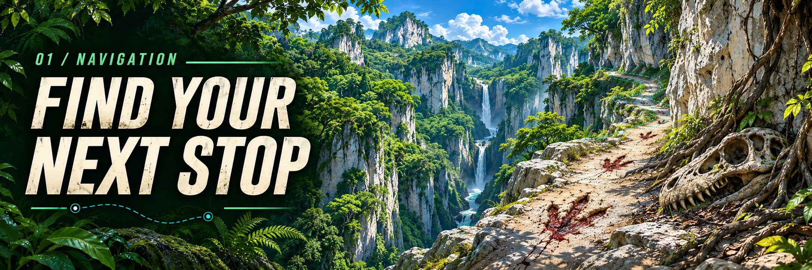
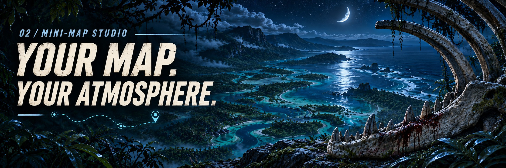
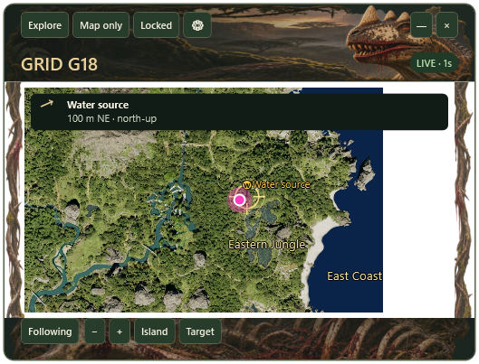
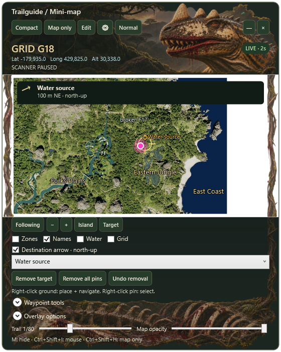
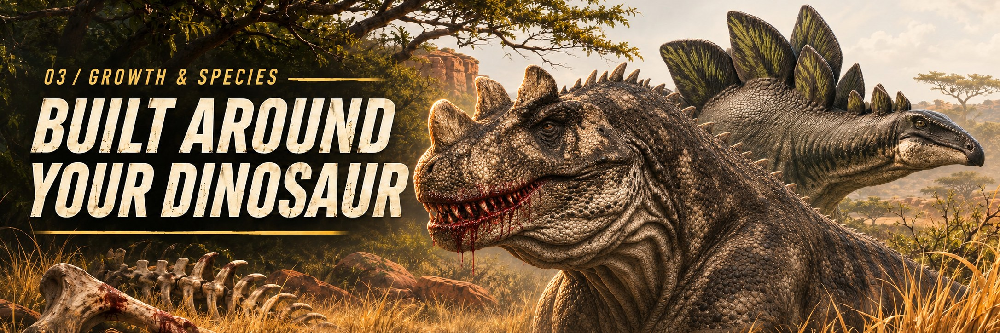
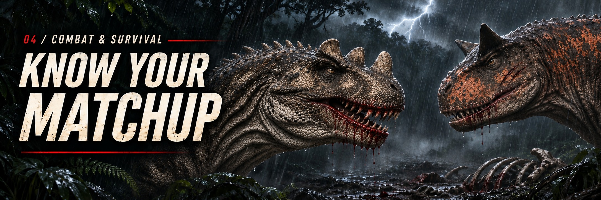
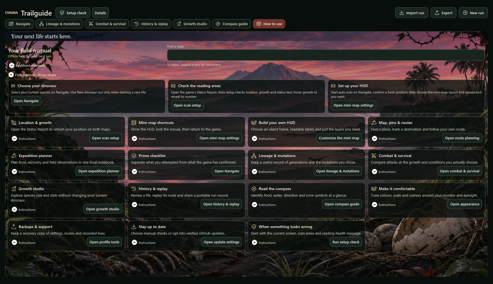
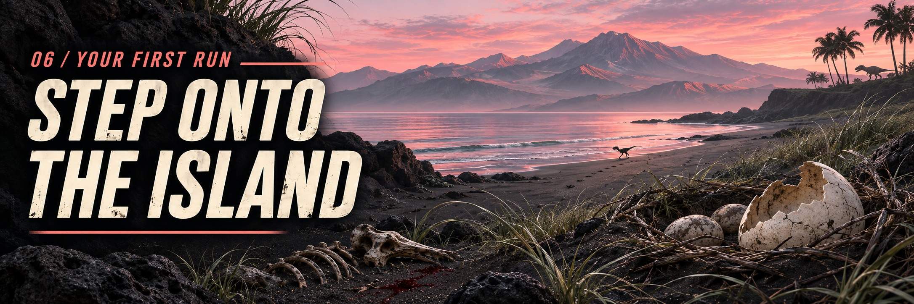

  

  
  
  

**Find your way. Plan your Prime. Keep your story.** Evrima Trailguide is a free Windows companion for **The Isle: Evrima**. Bring your map, dinosaur, objectives and run history together—then take a mini-map styled for the island back into the game.

🗺️ **Your own location** · 🧭 **Prime route planning** · 🦕 **Dinosaur references** · 🩸 **Combat estimates** · 📖 **Run replay**

**[Download for Windows](https://github.com/roid-apps/Evrima-Trailguide/releases/download/v1.28.1/EvrimaTrailguide-Setup-1.28.1.exe)** · [Watch the walkthrough](https://youtu.be/U__SdPqlwzQ) · [Report a bug / share an idea](https://github.com/roid-apps/Evrima-Trailguide/issues)

No account. Your screen readings and saved runs stay on your PC. [Privacy](PRIVACY.md)

## 🦴 Primal — choose your atmosphere

**Jungle cliffs. Storm-lit confrontations. Moonlit bones.** The optional **Primal** appearance brings six survival scenes, blood-and-bones imagery, translucent panels and subtle vine borders into the app. **New in 1.28.1:** a cinematic Primal mini-map frame wraps the overlay on all four sides. [See the update →](https://github.com/roid-apps/Evrima-Trailguide/releases/tag/v1.28.1)

Choose **Navigate → Tools → Appearance → Primal · blood & bones**, then tune scenery strength, panel opacity, edge details and motion. Prefer a clean field kit? Keep Classic or switch the scenery off. Existing preferences are retained; new profiles start with Classic.

## 🧭 Navigate

**One clear starting point: Plan my Prime route.** Open Evrima’s Status Report for a fresh position, then let Trailguide select nearby sanctuary, migration and patrol stops your run still needs. The plan adapts to accepted positions and recorded progress, with the next destination shared across the main map and mini-map.

Place your own nest, water, danger or meeting pins. Search the map, choose useful layers, and keep attempted and confirmed objectives distinct.

**Included from 1.28.0:** a larger map by default, compact controls across all seven workspaces, stronger OCR reacquisition, immediate pin/route redraws and smarter replay framing. [Read the 1.28.0 fixes →](https://github.com/roid-apps/Evrima-Trailguide/releases/tag/v1.28.0)

Start a **New run** after respawning or changing lives. Routes use mapped reference zones and straight-line distances, not guaranteed safe paths or live server-zone flags. Mapped visits remain attempts until verified in game; diet, nesting and other Prime requirements need their own checks.

## 🗺️ Mini-map studio

A compact companion for your next stop, framed by a bloodied Ceratosaurus, dark jungle, weathered ribs and tangled vines. The new **Primal · blood & bones** frame carries detailed survival artwork around all four sides, with narrow side borders outside the map.

Choose **Navigate → Map settings → Frame artwork → Primal · blood & bones**. Its dark green panels and warm bone-coloured text pair with the main app's Primal scenery. The frame is a separate choice; existing saved layouts keep their selected appearance.

- 🎨 **Make it yours:** separate terrain, panel and frame opacity; marker colours, trail styling, labels, layers, size and zoom.
- 🖱️ **Keep playing:** click-through map-only mode, automatic mouse locking on returning to gameplay and configurable recovery shortcuts.
- 💾 **Save your setup:** Gameplay, Ghost HUD, Explorer and High visibility presets, plus up to eight named layouts.
- ⚙️ **Edit from the main app:** **Map settings** beside **Show mini-map** works even while the overlay is hidden.

<strong>🦴 Explore the larger Primal mini-map</strong>

Open the expanded view for destination, layer and opacity controls. The frame adapts to the window while the dinosaur and bone details keep their proportions.

**Ghost HUD** hides the frame and controls for a transparent, click-through map-only view. High contrast also hides decorative artwork. The pictured positions come from isolated sample profiles, not live gameplay.

**Refresh from Status Report.** Trailguide reads your own visible coordinates. When they are hidden, it keeps the last accepted position and shows its age; it cannot reveal other players or track unseen movement. Borderless/windowed play is intended.

## 🦕 Dinosaur collection

**A recognizable face for every entry.** Explore the app’s 22 species portraits, choose your dinosaur and follow its growth. **Growth Studio** brings reference stages, silhouettes and stats together; **Lineage & mutations** keeps selected mutations and recorded generations with the run.

The portraits are AI-assisted illustrations based on Evrima game-model references. Measured silhouettes remain the growth and size reference; the collection is not a claim that every species is currently playable on every game branch.

## 🩸 Combat & survival

**Choose both dinosaurs. Pick their moves. Adjust growth.** Watch reference stats and hit estimates change together, with separate direct-damage and bleed results. Explore mutation scenarios and open the calculation details when you want to understand an estimate.

These are **reference comparisons**, not guaranteed fight outcomes. Timing, positioning and unmodelled mechanics still matter; version and compatibility notes remain available in the app.

## 📖 Your island field kit

Seven workspaces keep the next decision within reach:

| Open a workspace | What you can do |
| --- | --- |
| 🧭 **Navigate** | Find your position, mark personal stops and plan the Prime zones still needed. |
| 🧬 **Lineage & mutations** | Record generations, completed Entombs and chosen mutations. |
| 🩸 **Combat & survival** | Compare direct damage, bleed and survival references. |
| 📖 **History & replay** | Revisit archived lives, recorded routes and events; import or export runs. |
| 🦕 **Growth Studio** | Explore growth stages, silhouettes and reference stats. |
| 🧿 **Compass guide** | Recognize the direction, resource and zone symbols on Evrima’s compass. |
| 💡 **How to use** | Search 15 offline help topics and jump straight to the relevant controls. |

<strong>📖 Explore the updated route replay</strong>

Selecting a saved life frames its route once. Playback and later resizing preserve your chosen camera view.

**Keep the atmosphere—or turn it down.** Adjust scenery strength, panel opacity and decorative edges in **Navigate → Tools → Appearance**, or switch the artwork off. Existing users keep their selected appearance. Profile backups give your settings and recorded lives a recovery copy.

## 🌋 Start your next run

1. **Install:** [download stable 1.28.1 for Windows](https://github.com/roid-apps/Evrima-Trailguide/releases/download/v1.28.1/EvrimaTrailguide-Setup-1.28.1.exe). Close Trailguide before upgrading.
2. **Set up:** open **Setup check**, then the game’s **Status Report**. Use **Navigate → Tools → Scan setup → Auto setup** and inspect the capture areas.
3. **Explore:** confirm a fresh reading, select **Show mini-map**, and press **Plan my Prime route** when you are ready to plan.

**Watch it in action:** [full walkthrough](https://youtu.be/U__SdPqlwzQ) · [quick introduction](https://youtube.com/shorts/b4B2yn6n7Ws). The videos introduce the core workflow and predate the current interface.

<strong>⌨️ Shortcuts, growth readings and new dinosaur lives</strong>

**New/reset profiles:** `M` shows/hides the mini-map during focused gameplay · `Ctrl+Shift+I` toggles mouse interaction · `Ctrl+Shift+H` toggles map-only. Existing saved shortcuts stay unchanged.

Plain M requires the game cursor to be hidden and still reaches the game. Choose a modified visibility shortcut in **Map settings** if you need it in menus or chat.

Hover the game’s growth bar to reveal its precise percentage. Open Status Report when you need a location refresh, and inspect your capture regions if a reading is missing.

Use **New run** after death, respawning or switching dinosaur lives. A repeated growth decrease can trigger **Check dinosaur life**, but growth alone cannot identify every new life—especially one at similar or higher growth.

<strong>🔄 Optional automatic updates</strong>

Automatic installation starts **off**. Open **How to use → Stay up to date → Open update settings** to opt in.

Trailguide checks official GitHub releases, verifies the installer and waits for a normal app close before installing. Stable releases are the default; previews are a separate choice. Your game is never force-closed.

Automatic installation is for installed copies; all-users installations may require Windows administrator approval. Turning automatic updates off or changing channel cancels the pending update selection.

<strong>🛠️ Windows requirements, downloads and verification</strong>

Windows x64 · Windows 10 build 19041 or newer · .NET runtime included. English Windows OCR support may need enabling separately.

The [ZIP bundle](https://github.com/roid-apps/Evrima-Trailguide/releases/download/v1.28.1/EvrimaTrailguide-1.28.1-Windows.zip) contains the installer and notices; it is not a portable app. GitHub’s automatic source archives contain repository documentation, not the application.

Normal upgrades retain your profile. Keep a profile backup before upgrading.

[SHA-256 checksums](https://github.com/roid-apps/Evrima-Trailguide/releases/download/v1.28.1/SHA256SUMS.txt) · [Build-specific validation](https://github.com/roid-apps/Evrima-Trailguide/releases/download/v1.28.1/VALIDATION-v1.28.1.txt) · [Privacy statement](PRIVACY.md)

The installer is unsigned. An unfamiliar-app/SmartScreen reputation warning is not itself a malware detection. Use this repository’s release downloads and keep Windows protection enabled.

---

**🦴 Help shape the next expedition.** What helped you most? What got in your way? [Share feedback or report a bug](https://github.com/roid-apps/Evrima-Trailguide/issues). Include your Trailguide version, display setup and steps to reproduce the problem.

Made by **Roid** · Discord: **r_o_i_d** · [Email](mailto:b_greenspan@yahoo.com)

<strong>About the imagery and project</strong>

The main workspace screenshots show actual 1.28.0 controls with Primal scenery. The mini-map screenshots show the cinematic frame added for 1.28.1. All use isolated sample profiles and recorded/sample positions; they are not proof of live tracking during the capture session.

The cinematic header, scenery and portraits are decorative AI-assisted illustrations, not gameplay captures or exact map imagery. Section banners are AI-assisted concept illustrations checked against visual references. Trailguide is an independent fan project, not affiliated with The Isle’s developers. This repository hosts downloads and documentation; the application source is private.

The header’s Ceratosaurus artwork was checked against in-game screenshots and the visual references on [Evrima Quick Guide](https://www.evrimaquickguide.com/playables/quick-facts-carnivores/ceratosaurus).

