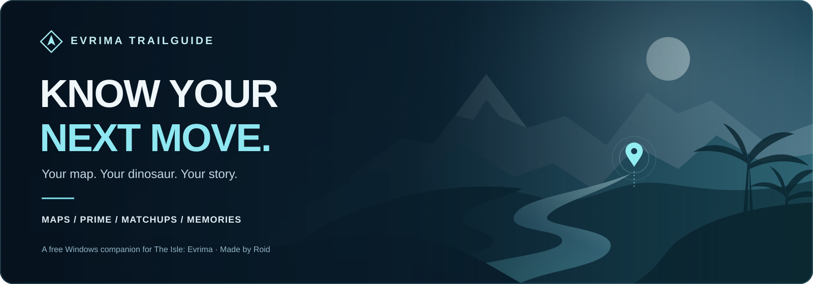
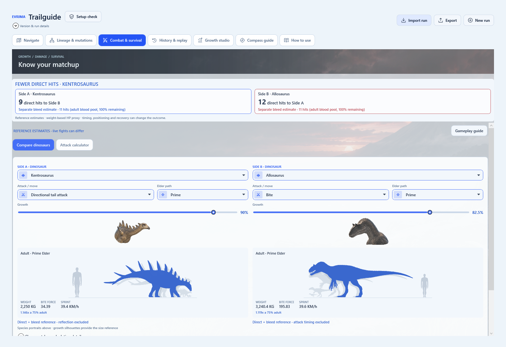
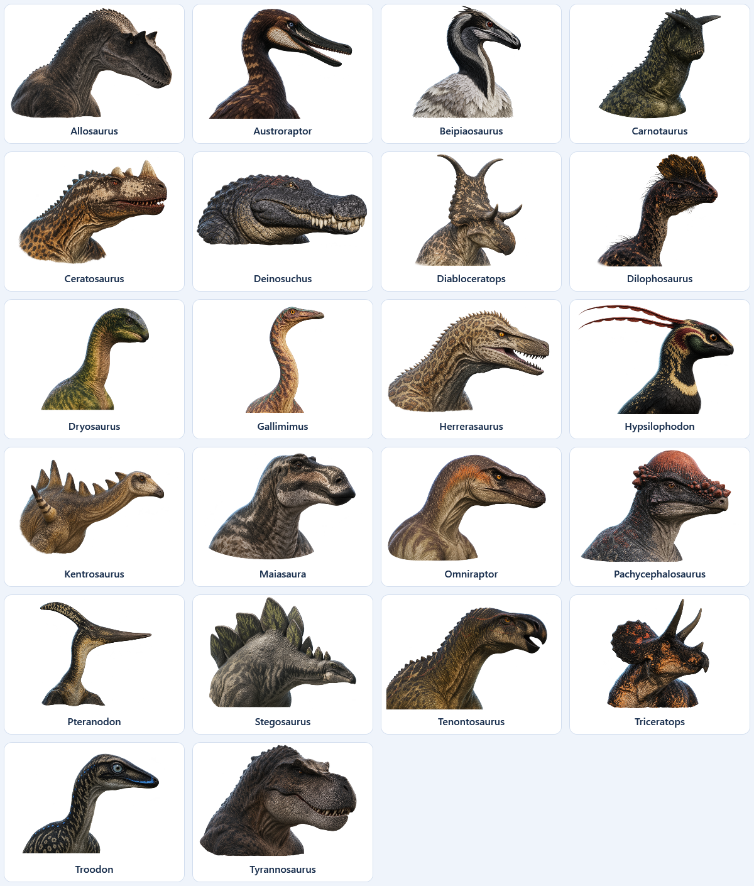
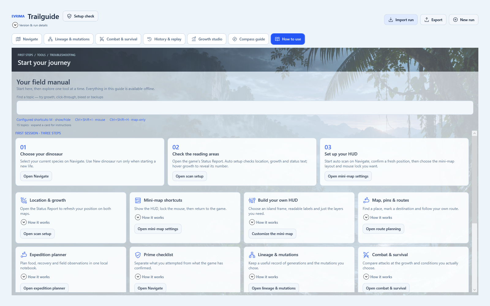

  

  
  
  

**Make the island feel familiar.** Evrima Trailguide brings your map, Prime checklist, dinosaur references and run history into one Windows companion. Mark your next stop, compare a matchup, and take a mini-map styled for your next adventure back into the game.

Free to use. No account. Your screen readings and saved runs stay on your PC.

## Your map, your atmosphere

**New in 1.27.2:** Prime navigation and mini-map controls stay in sync when you switch routes, stale distance and direction pause until a fresh reading arrives, and a new life check helps stop old Prime progress carrying into a different dinosaur life. Run exports also preserve gaps in tracking instead of drawing false travel lines.

Reference tooltips are now compact and follow your theme; detailed compatibility notes stay available in **Setup check**.

Press **Plan my Prime route** on Navigate, then open Status Report for a fresh location. The planner selects nearby sanctuary, migration and patrol stops still needed, adapting to accepted positions and recorded progress. Start a **New run** after respawning or changing dinosaur lives; the new growth check is a safeguard, not a replacement for that step. Mapped visits remain attempts until verified in game, while diet, nesting and other conditions need their own checks.

| Find your way | Grow with a plan | Know your matchup |
| --- | --- | --- |
| Follow accepted location readings, place personal pins and connect your next stops. | Keep attempted and confirmed Prime objectives distinct, with your dinosaur and growth in view. | Compare species, attacks and growth, with separate direct-hit and bleed estimates. |

The **Glacier** appearance pairs ice-white panels with cobalt controls. Choose another theme, adjust scenery strength or switch the artwork off in **Appearance**. Existing users keep their selected look.

## Build the mini-map you want to play with

| A compact companion | A transparent Ghost HUD |
| --- | --- |
|  |  |

- **Start with a preset:** Gameplay, Ghost HUD, Explorer or High visibility.
- **Choose your frame:** Glacier, Jungle canopy, Blood trail, Bone relic, Highlands or Minimal.
- **Set the atmosphere:** separate terrain, panel and frame opacity; essential markers and text stay readable.
- **Keep game controls available:** click-through map-only mode, automatic mouse locking when returning to gameplay and configurable recovery shortcuts.
- **Make it yours:** size, zoom, follow, layers, labels, marker colours, trail styling and up to eight named layouts.
- **Edit from either place:** **Map settings** beside **Show mini-map** shares the overlay’s preferences and works while the mini-map is hidden.

<strong>Explore the mini-map controls</strong>

Named waypoints, ordered route stops and navigation targets work alongside your chosen presentation. Appearance/layout resets retain your route, destination and shortcuts.

Trailguide reads **your own visible Status Report coordinates**. Open that screen to refresh both maps; when the numbers are hidden, the map keeps the last accepted fix and shows its age. It cannot reveal other players or track unseen movement. Route lines connect stops, not guaranteed safe paths. Borderless/windowed play is intended.

## See the dinosaur. Explore the numbers.

Choose both dinosaurs and their moves, then adjust growth to see reference stats and estimates change together. Separate mutation scenarios and calculation details are available when you want a closer look.

These are **reference comparisons**, not guaranteed fight outcomes. Timing, positioning and unmodelled mechanics still matter.

<strong>Meet the 22 dinosaur portraits</strong>

AI-assisted illustrations based on Evrima game-model references. Measured silhouettes remain the growth and size reference.

## Keep more than a location

| Explore | Remember |
| --- | --- |
| **Growth Studio** — compare stages and reference stats. | **History & replay** — revisit archived lives, routes and events. |
| **Compass guide** — recognize resource, direction and zone symbols. | **Lineage & mutations** — record generations and your chosen mutations. |
| **Expedition planner** — organize food references, recovery plans and field notes. | **Profile backups** — keep a recovery copy of settings and recorded runs. |

**New here? Open How to use.** Fifteen searchable topics explain the controls, show configured shortcuts and take you directly to relevant settings. The guide works offline.

<strong>A guide that stays beside the app</strong>

## Start your first run

1. **Install:** [download stable 1.27.2](https://github.com/roid-apps/Evrima-Trailguide/releases/download/v1.27.2/EvrimaTrailguide-Setup-1.27.2.exe). Close Trailguide before upgrading; keep a profile backup.
2. **Set up:** open **Setup check**, then Evrima’s **Status Report**. Choose **Scan setup → Auto setup** and inspect the capture areas.
3. **Explore:** start scanning, confirm a fresh reading and select **Show mini-map**. Hover the game’s growth bar to reveal the precise percentage.

**New/reset profiles:** `M` show/hide during focused gameplay · `Ctrl+Shift+I` mouse interaction · `Ctrl+Shift+H` map-only. **Existing saved shortcuts stay unchanged.** Plain M requires the game cursor to be hidden and still reaches the game; use Map settings to assign a modified show/hide shortcut if you need it in menus or chat.

**Choose how you update:** automatic installation starts **off**. Open **How to use → Stay up to date → Open update settings** to opt in. Trailguide checks official GitHub releases, verifies the installer and waits for a normal app close before installing. Stable is the default channel; preview releases are a separate choice. Your game is never force-closed.

[Full walkthrough](https://youtu.be/U__SdPqlwzQ) · [Quick introduction](https://youtube.com/shorts/b4B2yn6n7Ws) · [1.27.2 release notes](https://github.com/roid-apps/Evrima-Trailguide/releases/tag/v1.27.2)

The videos introduce the core workflow and predate the current interface.

<strong>Windows requirements, downloads and verification</strong>

Windows x64 · Windows 10 build 19041 or newer · .NET runtime included. English Windows OCR support may need enabling separately.

The [ZIP bundle](https://github.com/roid-apps/Evrima-Trailguide/releases/download/v1.27.2/EvrimaTrailguide-1.27.2-Windows.zip) contains the installer and notices; it is not a portable app. GitHub’s automatic source archives contain repository documentation, not the application.

[SHA-256 checksums](https://github.com/roid-apps/Evrima-Trailguide/releases/download/v1.27.2/SHA256SUMS.txt) · [Build-specific validation](https://github.com/roid-apps/Evrima-Trailguide/releases/download/v1.27.2/VALIDATION-v1.27.2.txt) · [Privacy statement](PRIVACY.md)

Normal upgrades retain your profile. Automatic installation is for installed copies; all-users installations may require Windows administrator approval. Turning automatic updates off or changing channel cancels the pending update selection.

The installer is unsigned. An unfamiliar-app/SmartScreen reputation warning is not itself a malware detection. Use this repository’s release downloads and keep Windows protection enabled.

## Help shape the next run

**What helped you most? What got in your way?** [Share feedback or report a bug](https://github.com/roid-apps/Evrima-Trailguide/issues). For a bug, include your Trailguide version, display setup and the steps that reproduce it.

Made by **Roid** · Discord: **r_o_i_d** · [Email](mailto:b_greenspan@yahoo.com)

Screenshots show actual application controls with isolated sample profiles; the navigation and mini-map views are from 1.27.1. The current release preserves these layouts and adds the fixes described above. Scenery and portraits are decorative AI-assisted illustrations, not gameplay captures or exact map imagery. Trailguide is an independent fan project, not affiliated with The Isle’s developers. This repository hosts downloads and documentation; the application source is private.

