

  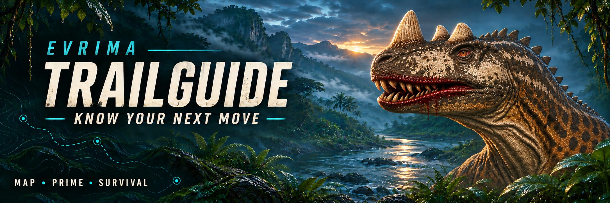

  
  
  

**Find your way. Plan your Prime. Keep your story.** Evrima Trailguide is a free Windows companion for **The Isle: Evrima**. Bring your map, dinosaur, objectives and run history together—then take a mini-map styled for the island back into the game.

🗺️ **Your own location** · 🧭 **Prime route planning** · 🦕 **Dinosaur references** · 🩸 **Combat estimates** · 🧬 **Bloodlines** · 📖 **Run replay**

**[Download for Windows](https://github.com/roid-apps/Evrima-Trailguide/releases/download/v1.29.1/EvrimaTrailguide-Setup-1.29.1.exe)** · [Watch the walkthrough](https://youtu.be/U__SdPqlwzQ) · [Report a bug / share an idea](https://github.com/roid-apps/Evrima-Trailguide/issues)

No account. Your screen readings and saved runs stay on your PC. [Privacy](PRIVACY.md)

> **Artwork preview from local development build; stable 1.29.1 download retains earlier artwork.** The images below preview the Ceratosaurus art refresh. The download and release details still describe stable 1.29.1.

## 🩸 New in 1.29.1 — know what a hit can do

**A small health estimate. A deeper combat reference.** This update adds an optional mini-map health indicator, Ceratosaurus charge previews, target-specific damage regions, and **Head / Body / Legs** bone-health references with Pachy fracture calculations. Attack coverage and growth scaling have been reviewed across all **22 released species**, and qualified Ceratosaurus attacks now have corrected bleed calculations. [Read the release notes →](https://github.com/roid-apps/Evrima-Trailguide/releases/tag/v1.29.1)

<table>
  <tr>
    <td width="50%">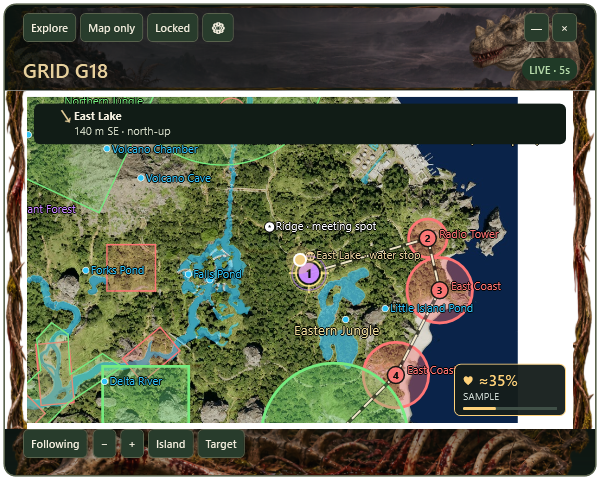 <strong>❤️ Wounded-health estimate</strong> A passive, optional indicator with clear stale and unavailable states.</td>
    <td width="50%">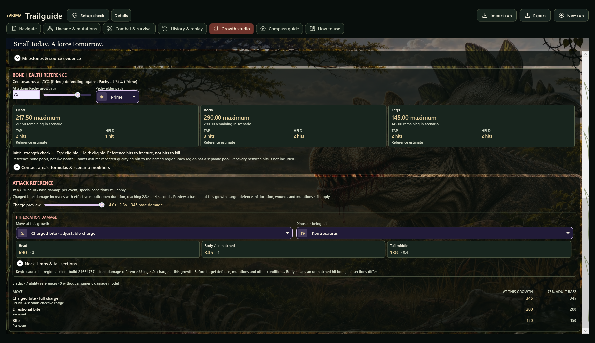 <strong>🦴 Know your bone pools</strong> Explore regional durability at your dinosaur’s growth and Elder branch.</td>
  </tr>
</table>

These are qualified **reference estimates**, not live HP telemetry or guaranteed fight outcomes. Unverified ability values stay unavailable; a sample screenshot does not establish live gameplay validation.

## 🦴 Primal Habitats — your dinosaur, your atmosphere

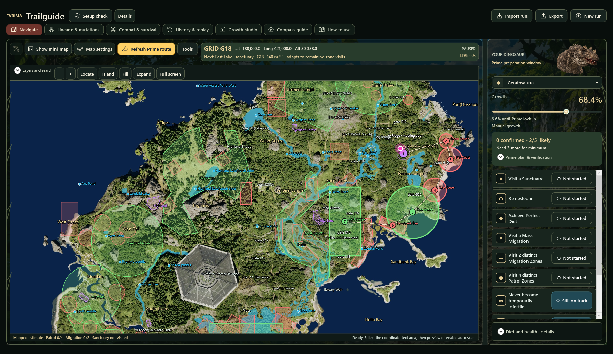

**Cold swamp mist. Drifting volcanic ash. Silver surf. Rust-red highlands.** Keep the four environment packs, personalized full-wrap Primal mini-map, visual **Bloodlines** tree and shareable appearance presets introduced in 1.29.0. Preview a look before applying it, and undo it when you want a change.

The optional **Primal · blood & bones** appearance brings cinematic survival scenery, skeletal remains, blood, translucent panels and vine borders into the app. Choose **Navigate → Tools → Appearance**, enable Primal, and pick an **Environment**. **Original** keeps the existing scene for each tab. Tune scenery strength, panel opacity, edge details and motion—or keep Classic. Existing preferences are retained; new profiles start with Classic.

<table>
  <tr>
    <td width="50%"> <strong>🌿 Swamp mist</strong> Cold green water, hanging roots and a shroud of mist.</td>
    <td width="50%">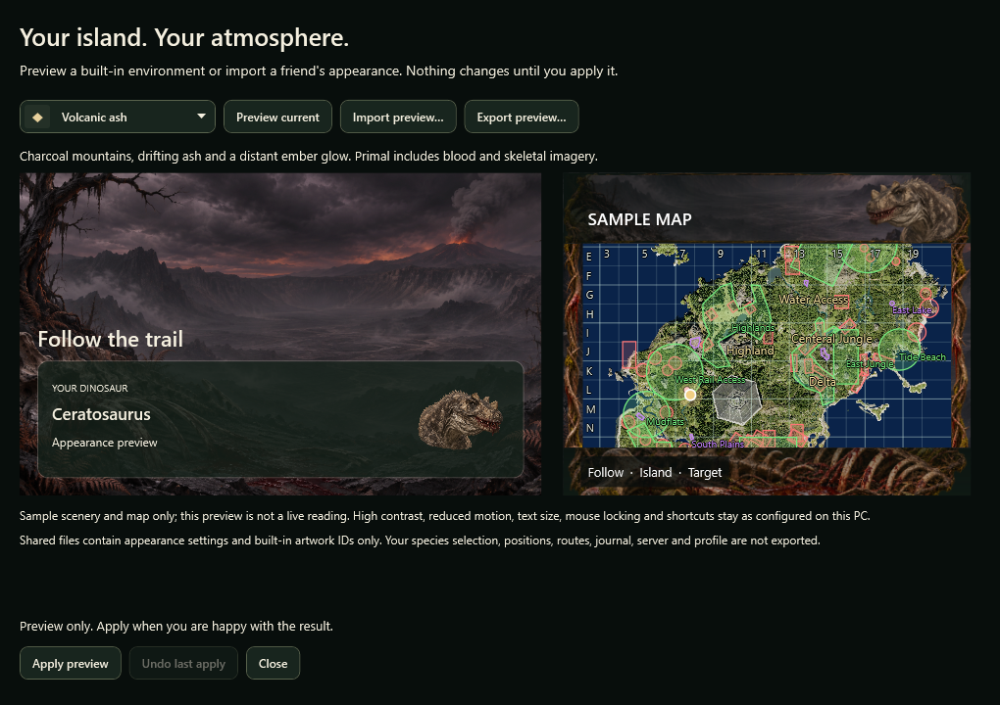 <strong>🌋 Volcanic ash</strong> Charcoal mountains, drifting ash and a distant ember glow.</td>
  </tr>
  <tr>
    <td width="50%">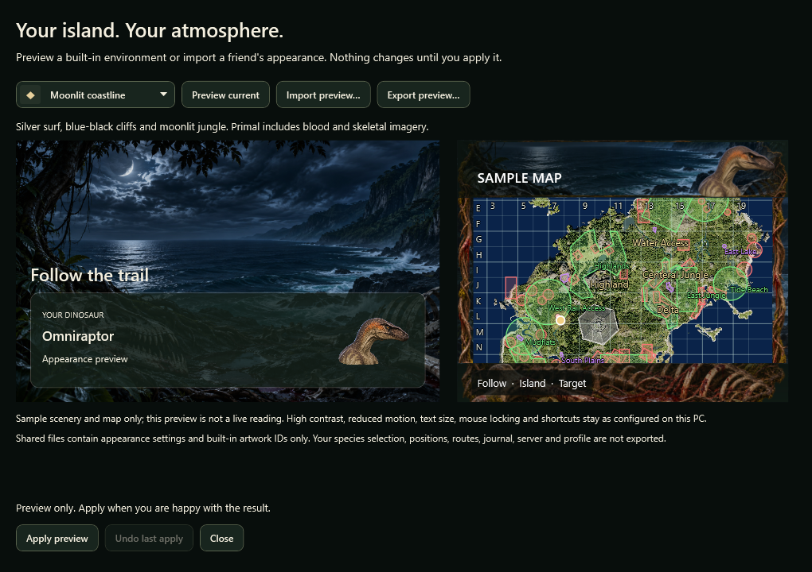 <strong>🌙 Moonlit coastline</strong> Silver surf, blue-black cliffs and moonlit jungle.</td>
    <td width="50%">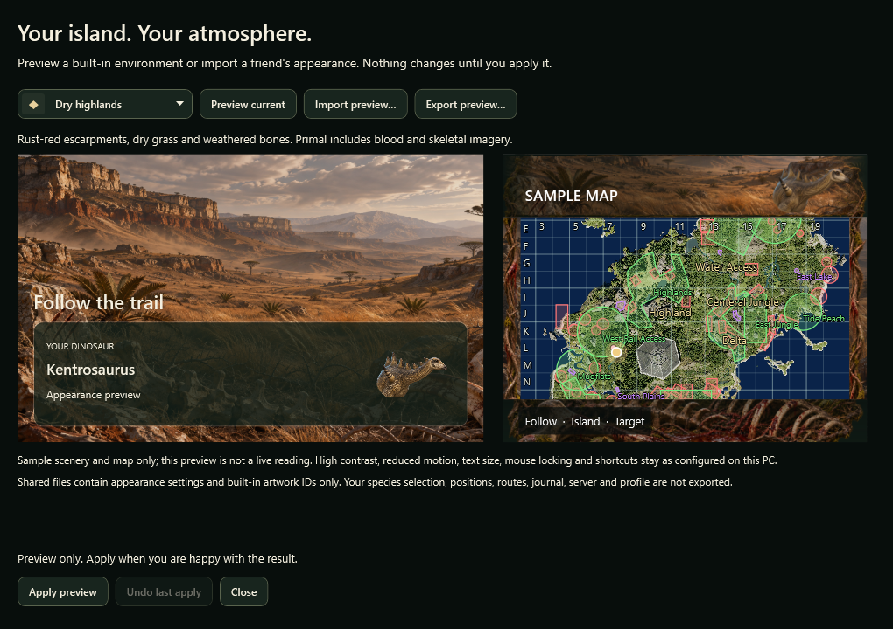 <strong>🏔️ Dry highlands</strong> Rust-red escarpments, dry grass and weathered bones.</td>
  </tr>
</table>

Environments are manually chosen decorative artwork. They do not detect your biome or in-game weather, and they do not change the map's terrain or coordinates.

## 🧭 Navigate

**One clear starting point: Plan my Prime route.** Open Evrima’s Status Report for a fresh position, then let Trailguide select nearby sanctuary, migration and patrol stops your run still needs. The plan adapts to accepted positions and recorded progress, with the next destination shared across the main map and mini-map.

Place your own nest, water, danger or meeting pins. Search the map, choose useful layers, and keep attempted and confirmed objectives distinct. A large navigation map and compact controls keep the terrain in view.

Start a **New run** after respawning or changing lives. Routes use mapped reference zones and straight-line distances, not guaranteed safe paths or live server-zone flags. Mapped visits remain attempts until verified in game; diet, nesting and other Prime requirements need their own checks.

## 🗺️ Mini-map studio

**Let the frame belong to your dinosaur.** The full-wrap Primal mini-map combines your chosen habitat with one of the app’s **22 species portraits**. Weathered ribs fill the footer; vines frame both sides outside the terrain. Artwork adapts to compact and expanded layouts while preserving the dinosaur’s proportions.

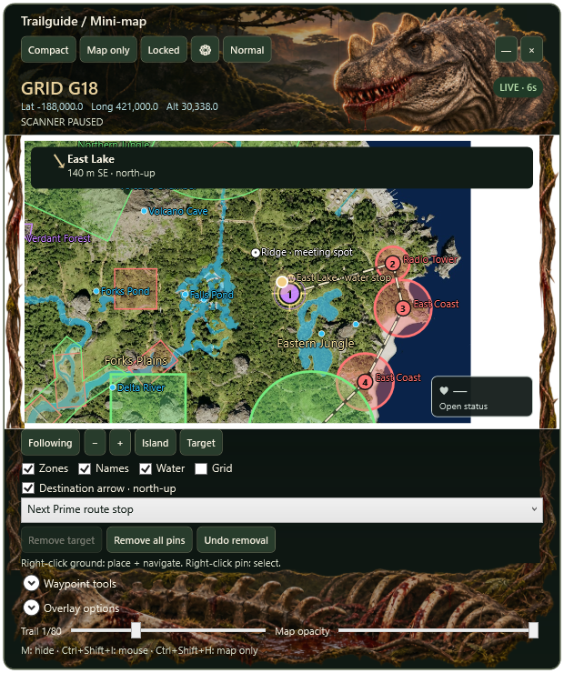

**The original Primal frame, refreshed.** Preview the more game-faithful Ceratosaurus with the original cinematic jungle frame, or personalize the frame with a species portrait and one of the habitats below.

<table>
  <tr>
    <td width="50%">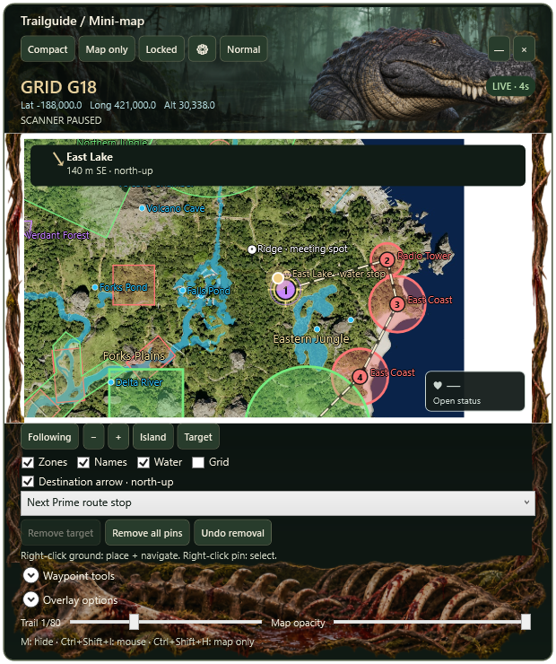 <strong>🌿 Swamp mist</strong></td>
    <td width="50%">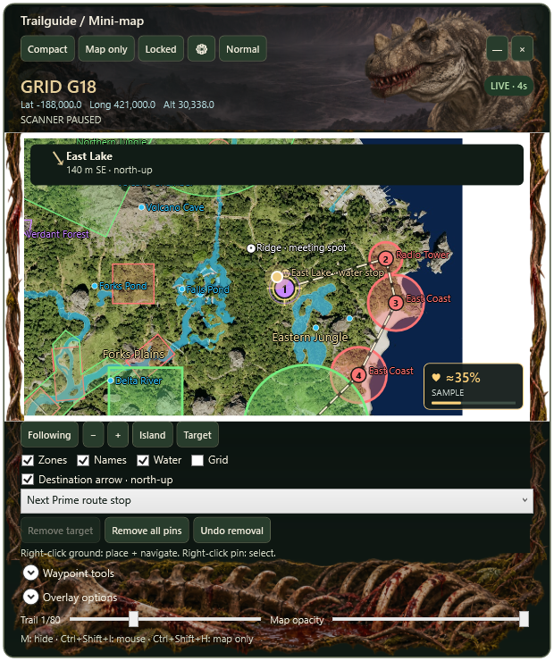 <strong>🌋 Volcanic ash</strong></td>
  </tr>
  <tr>
    <td width="50%">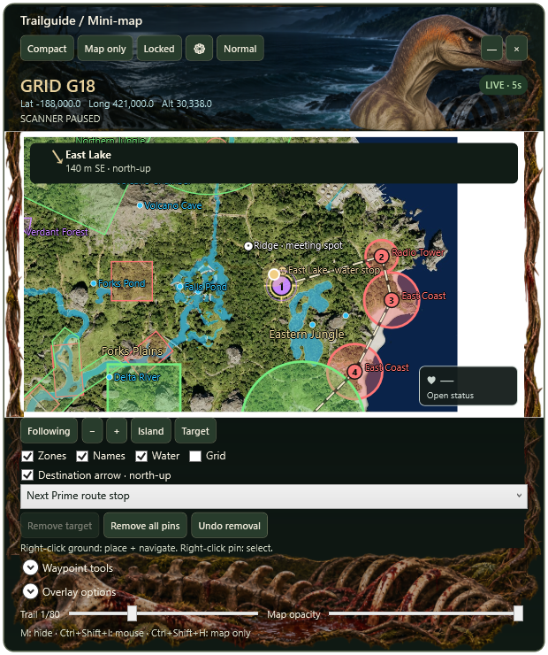 <strong>🌙 Moonlit coastline</strong></td>
    <td width="50%">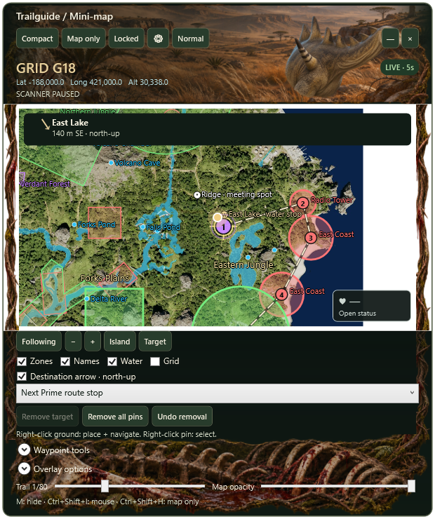 <strong>🏔️ Dry highlands</strong></td>
  </tr>
</table>

Choose **Navigate → Map settings → Frame artwork → Primal · blood & bones**. Enable **Feature my dinosaur on the Primal mini-map** in Appearance or Map settings, then select an environment. The frame remains a separate choice from the main app’s Primal scenery. Existing layouts keep their appearance until you change it.

- 🎨 **Make it yours:** separate terrain, panel and frame opacity; marker colours, trail styling, labels, layers, size and zoom.
- 🖱️ **Keep playing:** click-through map-only mode, automatic mouse locking on returning to gameplay and configurable recovery shortcuts.
- 💾 **Save your setup:** Gameplay, Ghost HUD, Explorer and High visibility presets, plus up to eight named layouts.
- ⚙️ **Edit from the main app:** **Map settings** beside **Show mini-map** works even while the overlay is hidden.

**❤️ An approximate health reading, tucked into the bottom-right corner.** Enable or hide **Map settings → Health estimate · bottom right**. The indicator uses a matched visible Status Report and recent growth to estimate wounded health for the selected dinosaur. Above half health, it shows a range rather than claiming an exact percentage. It marks readings stale after eight seconds; it cannot track damage or recovery while Status Report is closed. Missing, contradictory or mismatched readings stay unavailable. The model is experimental and can be affected by mutations, diet or server changes.

<strong>🦴 Explore the larger Primal mini-map</strong>

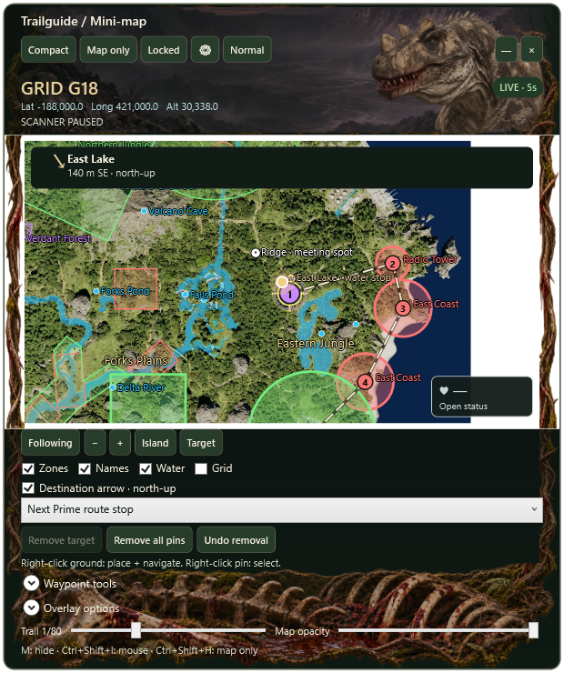

Open the expanded view for destination, layer and opacity controls. **Ghost HUD** hides the frame and controls for a transparent, click-through map-only view. High contrast hides decorative artwork too, including when the Windows setting changes while the mini-map is open.

The artwork receives no mouse or keyboard input. Changing an environment or portrait leaves your location, zoom, route and shortcuts intact.

**Refresh from Status Report.** Trailguide reads your own visible coordinates. When they are hidden, it keeps the last accepted position and shows its age; it cannot reveal other players or track unseen movement. Borderless/windowed play is intended.

## 🧬 Bloodlines — every life leaves a trail

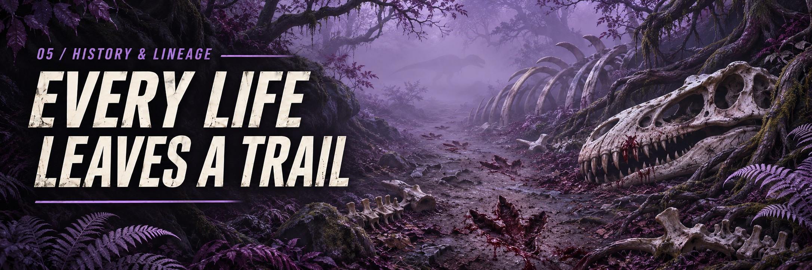

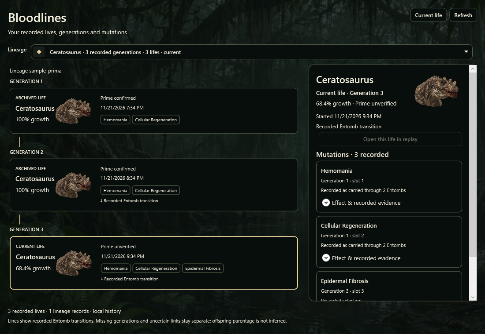

Open **Lineage & mutations → Explore lineage tree** to see recorded lives, generations and mutations together. Select a life to inspect its mutation records or open its archived route in replay. Compact cards keep the chain visible, with details beside it on larger windows.

Connections show **recorded Entomb transitions**. Missing generations, ambiguous records and legacy lives remain separate; the tree does not infer biological parentage or invent inheritance values.

## 🎨 Preview it. Share it. Make it yours.

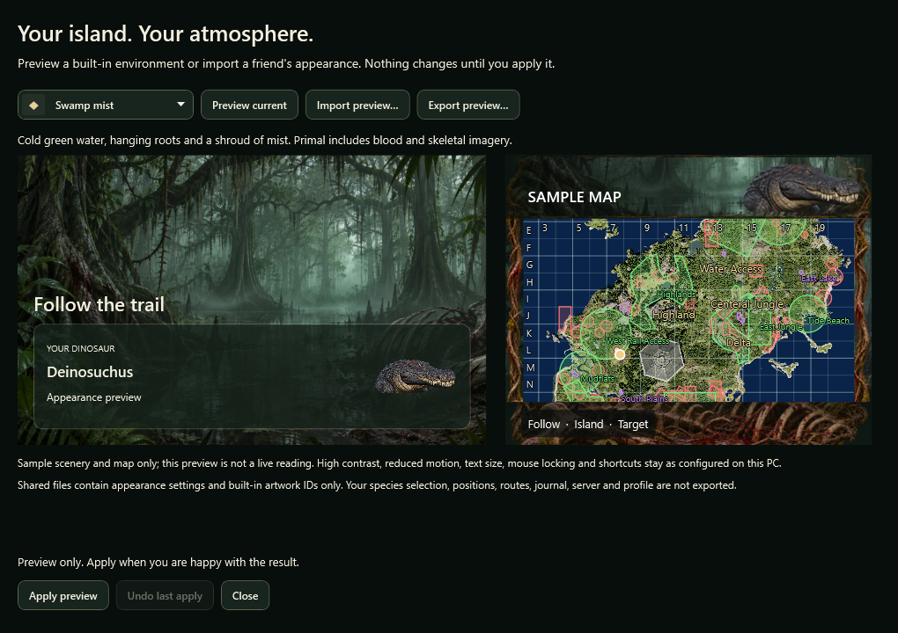

Open **Navigate → Tools → Appearance → Appearance presets**. Try a built-in environment or import a friend’s look, inspect the preview, then choose **Apply preview**. Closing without Apply leaves your saved appearance alone. **Undo last apply** restores the previous look while preserving newer navigation progress.

Shared presets contain appearance settings and bundled artwork choices. Your species selection, coordinates, routes, recorded lives, server information, hotkeys and window placement stay local. Accessibility and motion choices stay configured on your PC.

Open previews follow species and accessibility changes. Camera movement and route progress do not rebuild them, keeping decorative previews separate from the tracking work.

## 🦕 Dinosaur collection

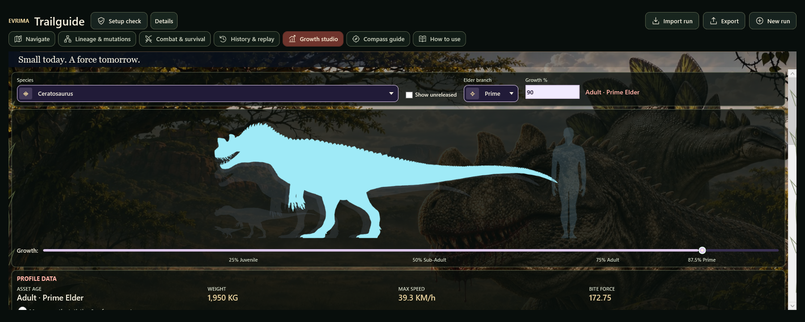

**A recognizable face for every entry.** Explore the app’s 22 species portraits, choose your dinosaur and follow its growth. **Growth Studio** brings reference stages, silhouettes and stats together; **Lineage & mutations** keeps selected mutations and recorded generations with the run.

**Choose a move and a target.** Compare damage to the head, body and tail, then expand neck, limb and other species-specific regions. Supported attacks follow growth and Prime/Frail scaling. Ceratosaurus has a **0–4 second effective mouth-open charge preview**; full charge is **2.3× ordinary bite** before target and scenario adjustments. Separate contact events, pounce cycles and conditional abilities retain their own rules.

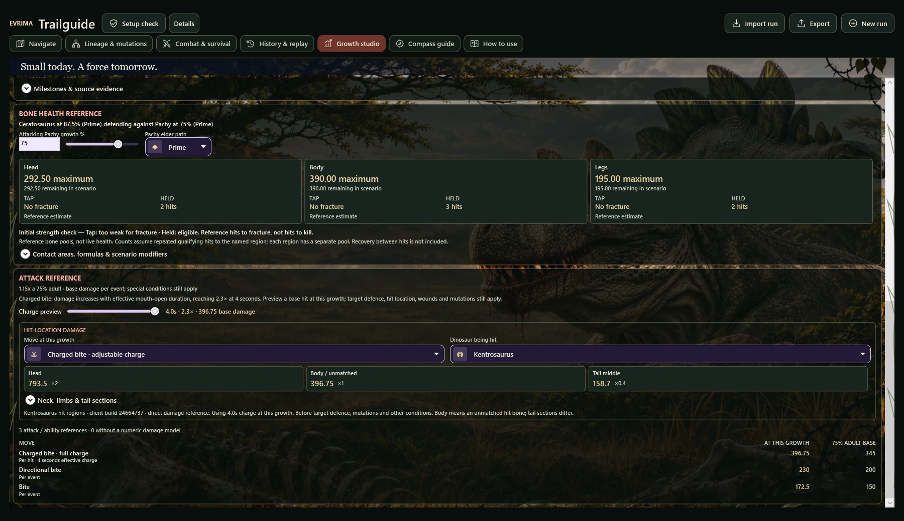

**🦴 How many Pachy headbutts can your dinosaur take?** Open the **Bone health reference** in Growth Studio. Set the defender’s species, growth and Elder branch, then adjust the Pachy attacker independently. Head, Body and Legs show maximum and remaining bone pools alongside tap and held-headbutt estimates. Viewing Pachy also lets you choose a different target. Existing regional damage, fracture resistance, relevant mutations and attacker injury can change the result.

Fracture counts assume qualifying repeated contacts to the selected region, with no healing or parry. A hit must meet the fracture threshold; some head contacts redirect to Body, and some areas cannot contribute through this attack path. Ordinary HP may run out before a bone fractures. The four unreleased reference entries do not receive invented bone values.

The portraits are AI-assisted illustrations based on Evrima game-model references. Measured silhouettes remain the growth and size reference; the collection is not a claim that every species is currently playable on every game branch.

## 🩸 Combat & survival

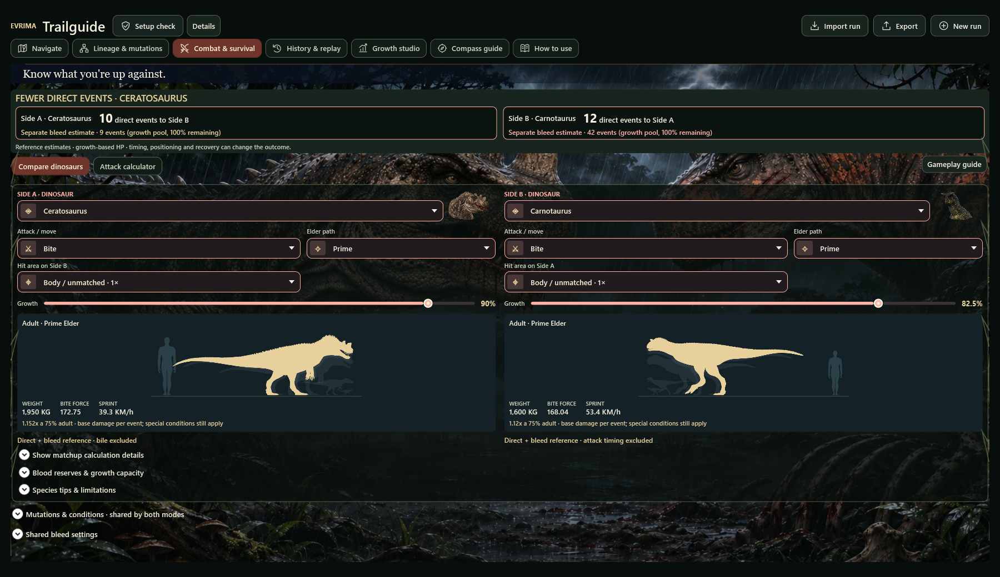

**Choose both dinosaurs. Pick their moves. Adjust growth and hit area.** Watch reference stats and event estimates change together, with separate direct-damage and bleed results. Region multipliers belong to the **target dinosaur**, and attacks that bypass ordinary hit regions keep their separate rules. The attack calculator includes compact Pachy fracture cards tied to the selected stages and mutations.

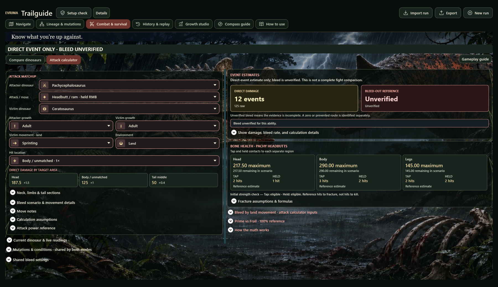

**🩸 Bleed follows the selected scenario.** Qualified Ceratosaurus bite, directional bite and charged bite use final direct damage, target defense and the applicable bleed thresholds. Current-growth blood capacity is the default; the older chart pool is an explicit historical comparison. Choose land movement or a swimming speed band, inspect resistance, and use a finite wound duration with the post-hit vitals helper.

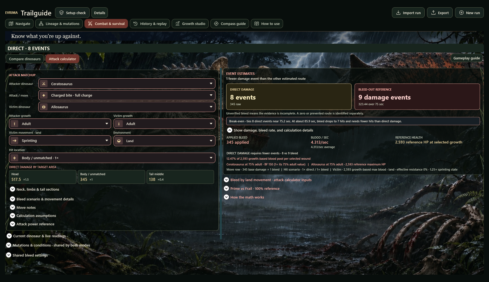

<strong>🩸 Movement, wound duration and calculation limits</strong>

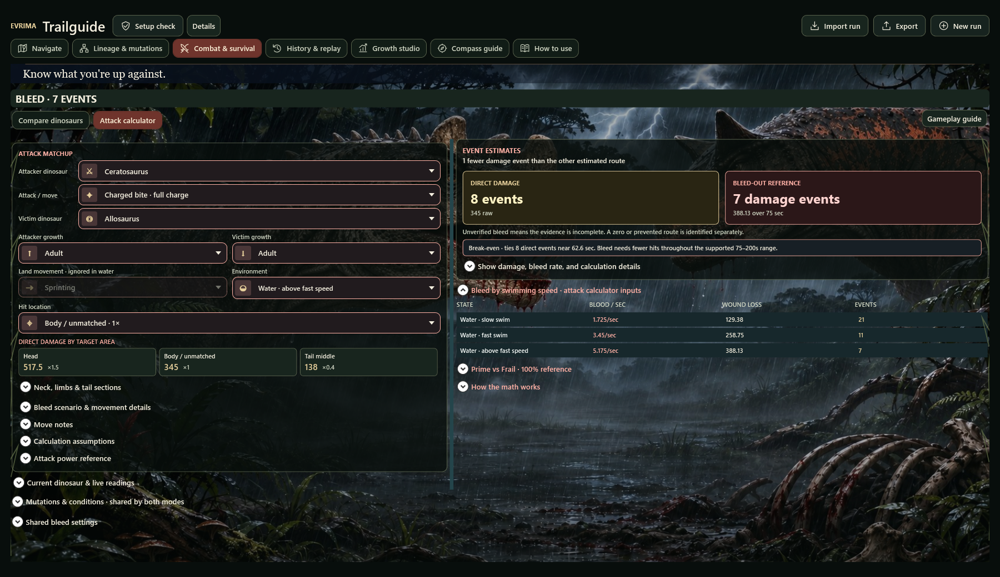

Mixed land movement uses a weighted loss rate. Water has separate slow, fast and above-fast speed bands; land resting protection is not applied underwater. Wounded Ceratosaurus resistance, Beipiaosaurus water resistance, wound expiry and lethal-direct-hit handling are included where qualified.

An event estimate assumes the selected repeated contacts and conditions. It is not a complete fight simulation or a death countdown. Unknown ability bleed stays **Unverified**, rather than becoming zero. Carno’s continuous headbutt curve, conditional Rex throw damage, Hypsi spit damage scaling and complete hallucination/venom sequences still have unresolved details.

These are **reference comparisons**, not guaranteed fight outcomes. Timing, positioning and unmodelled mechanics still matter; version and compatibility notes remain available in the app.

## 📖 Your island field kit

Seven workspaces keep the next decision within reach:

| Open a workspace | What you can do |
| --- | --- |
| 🧭 **Navigate** | Find your position, mark personal stops and plan the Prime zones still needed. |
| 🧬 **Lineage & mutations** | Record generations, completed Entombs and chosen mutations; explore the Bloodlines tree. |
| 🩸 **Combat & survival** | Compare target-area damage, Pachy fractures and finite bleed scenarios. |
| 📖 **History & replay** | Revisit archived lives, recorded routes and events; import or export runs. |
| 🦕 **Growth Studio** | Explore growth, attack scaling, hit regions and regional bone health. |
| 🧿 **Compass guide** | Recognize the direction, resource and zone symbols on Evrima’s compass. |
| 💡 **How to use** | Search 15 offline help topics and jump straight to the relevant controls. |

<strong>📖 Explore route replay</strong>

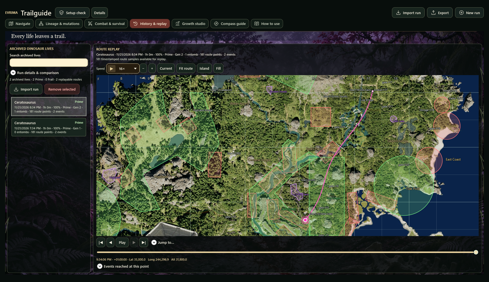

Selecting a saved life frames its route once. Playback and later resizing preserve your chosen camera view.

**Keep the atmosphere—or turn it down.** Adjust scenery strength, panel opacity and decorative edges in **Navigate → Tools → Appearance**, or switch the artwork off. Existing users keep their selected appearance. Profile backups give your settings and recorded lives a recovery copy.

## 🌋 Start your next run

1. **Install:** [download stable 1.29.1 for Windows](https://github.com/roid-apps/Evrima-Trailguide/releases/download/v1.29.1/EvrimaTrailguide-Setup-1.29.1.exe). Close Trailguide before upgrading.
2. **Set up:** open **Setup check**, then the game’s **Status Report**. Use **Navigate → Tools → Scan setup → Auto setup** and inspect the capture areas.
3. **Explore:** confirm a fresh reading, select **Show mini-map**, and press **Plan my Prime route** when you are ready to plan.
4. **Make it yours:** choose a Primal environment in **Appearance**, personalize your mini-map and preview a shareable look.

**Watch it in action:** [full walkthrough](https://youtu.be/U__SdPqlwzQ) · [quick introduction](https://youtube.com/shorts/b4B2yn6n7Ws). The videos introduce the core workflow and predate the current interface.

<strong>⌨️ Shortcuts, growth readings and new dinosaur lives</strong>

**New/reset profiles:** `M` shows/hides the mini-map during focused gameplay · `Ctrl+Shift+I` toggles mouse interaction · `Ctrl+Shift+H` toggles map-only. Existing saved shortcuts stay unchanged.

Plain M requires the game cursor to be hidden and still reaches the game. Choose a modified visibility shortcut in **Map settings** if you need it in menus or chat.

Hover the game’s growth bar to reveal its precise percentage. Open Status Report when you need a location refresh, and inspect your capture regions if a reading is missing.

Use **New run** after death, respawning or switching dinosaur lives. A repeated growth decrease can trigger **Check dinosaur life**, but growth alone cannot identify every new life—especially one at similar or higher growth.

<strong>🔄 Optional automatic updates</strong>

Automatic installation starts **off**. Open **How to use → Stay up to date → Open update settings** to opt in.

Trailguide checks official GitHub releases, verifies the installer and waits for a normal app close before installing. Stable releases are the default; previews are a separate choice. Your game is never force-closed.

Automatic installation is for installed copies; all-users installations may require Windows administrator approval. Turning automatic updates off or changing channel cancels the pending update selection.

<strong>🛠️ Windows requirements, downloads and verification</strong>

Windows x64 · Windows 10 build 19041 or newer · .NET runtime included. English Windows OCR support may need enabling separately.

The [ZIP bundle](https://github.com/roid-apps/Evrima-Trailguide/releases/download/v1.29.1/EvrimaTrailguide-1.29.1-Windows.zip) contains the installer and notices; it is not a portable app. GitHub’s automatic source archives contain repository documentation, not the application.

Normal upgrades retain your profile. Keep a profile backup before upgrading.

[SHA-256 checksums](https://github.com/roid-apps/Evrima-Trailguide/releases/download/v1.29.1/SHA256SUMS.txt) · [Build-specific validation](https://github.com/roid-apps/Evrima-Trailguide/releases/download/v1.29.1/VALIDATION-v1.29.1.txt) · [Privacy statement](PRIVACY.md)

The installer is unsigned. An unfamiliar-app/SmartScreen reputation warning is not itself a malware detection. Use this repository’s release downloads and keep Windows protection enabled.

---

**🦴 Help shape the next expedition.** What helped you most? What got in your way? [Share feedback or report a bug](https://github.com/roid-apps/Evrima-Trailguide/issues). Include your Trailguide version, display setup and steps to reproduce the problem.

Made by **Roid** · Discord: **r_o_i_d** · [Email](mailto:b_greenspan@yahoo.com)

<strong>About the imagery and project</strong>

The application screenshots show an artwork preview from the local development build with Primal scenery. The published stable 1.29.1 installer retains the earlier artwork; these previews do not announce a new stable release. All use isolated sample profiles and recorded/sample positions; they are not live gameplay captures or proof of tracking during the capture session. The health demonstration is explicitly marked **SAMPLE** and uses illustrative evidence.

Combat, fracture and bleed references include an offline review of installed client build **24664737**. The audit is tied to that reference build, not proof of every current live-server version or interaction. Stable 1.29.1 passed **2,489 automated tests with zero failures or skips**; see the release validation report for the tested scope and remaining limits.

The cinematic header, scenery and portraits are decorative AI-assisted illustrations, not gameplay captures or exact map imagery. Section banners are AI-assisted concept illustrations checked against visual references. Trailguide is an independent fan project, not affiliated with The Isle’s developers. This repository hosts downloads and documentation; the application source is private.

The header’s Ceratosaurus artwork was checked against in-game screenshots and the visual references on [Evrima Quick Guide](https://www.evrimaquickguide.com/playables/quick-facts-carnivores/ceratosaurus).

