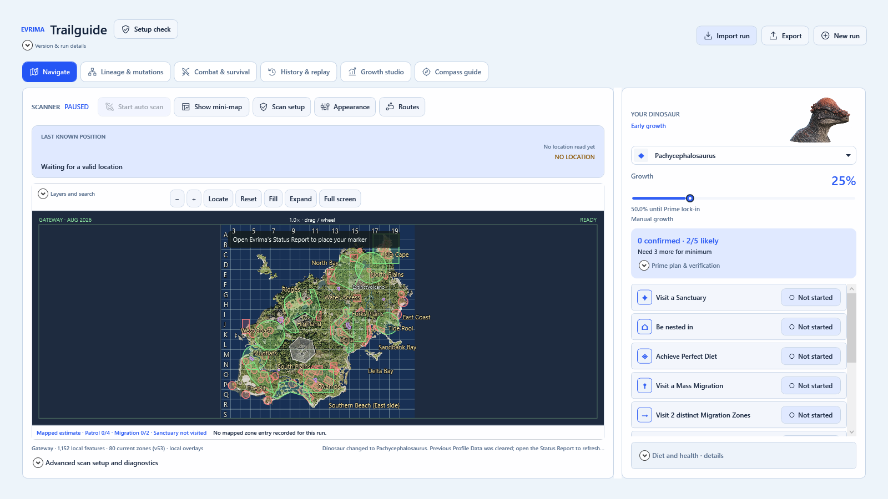
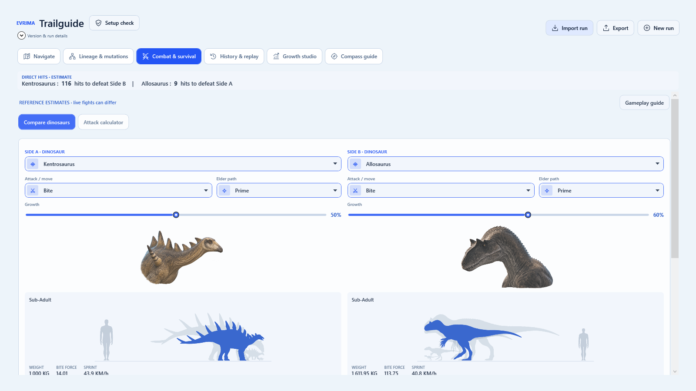
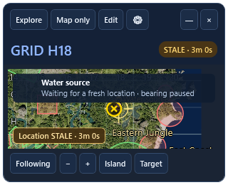
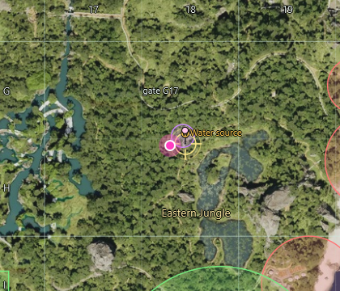

# Evrima Trailguide 1.26.0 — Glacier

**A clearer view. More dependable readings. Your next run, better organized.**

Glacier gives Trailguide a fresh map-first workspace, 22 dinosaur portraits and cleaner controls. Underneath the new look, this update tackles interrupted location updates, missed growth readings and mini-map interaction problems.

[Download the Windows installer](https://github.com/roid-apps/Evrima-Trailguide/releases/download/v1.26.0/EvrimaTrailguide-Setup-1.26.0.exe) · [Installer ZIP bundle](https://github.com/roid-apps/Evrima-Trailguide/releases/download/v1.26.0/EvrimaTrailguide-1.26.0-Windows.zip) · [Watch the walkthrough](https://youtu.be/U__SdPqlwzQ)

## Meet Glacier

- Ice-white panels, cobalt actions, rounded controls and a map-first layout, with your dinosaur and Prime checklist alongside it.
- Distinct vector icons for Navigate, Lineage, Combat, History, Growth and Compass, plus the main toolbar actions.
- Separate **Appearance**, **Scan setup** and **Routes** menus. More space for the map; fewer repeated explanations.
- **22 model-referenced dinosaur portraits** in navigation and combat. Existing measured silhouettes remain the growth and size reference.
- One Growth Studio slider, with additional statistics tucked into expandable details.
- Better text contrast across fourteen reviewed appearances, corrected preset accent colors, and subtle feedback that respects Windows animation settings.

Existing users keep their selected theme. Choose **Appearance → Glacier** to switch; new profiles start with Glacier.

## Readings that recover properly

- Location scanning runs independently of status/growth OCR. A slow secondary reading no longer holds up the coordinate worker.
- Scan cadence accounts for processing time, and accepted readings update the marker and timestamp together.
- Complete, plausible coordinate bursts can recover after blind travel without inheriting the old long confirmation sequence. Suspicious sign changes, missing digits and implausible jumps still require corroboration.
- Tighter automatic capture areas and a bounded contrast retry help with glowing Status Report text. Anchored capture regions follow supported game-window moves and proportional resizing; changed aspect ratios ask for setup instead of guessing.
- Manual corrections invalidate older in-flight captures. Stationary readings refresh freshness without filling the trail with duplicate points.
- **Growth recognition now handles thin/dim meter outlines, off-center hover tooltips and dropped decimal characters.** Diet growth-rate bonuses cannot replace actual growth, and an unreadable retry cannot invent 0% growth.

## A calmer mini-map

| Compact navigation and a subtle stale indicator | Map-only view |
| --- | --- |
|  |  |

- Small mouse movements no longer accidentally pause following.
- Map-only/locked mode closes an open interactive customization window.
- Saved presets respect recovery-hotkey protection before locking input.
- Route-import preview preserves the overlay size you chose.
- Accepted location fixes update follow immediately; freshness remains distinct from whether the scanner is running.

Your existing opacity, marker/trail styling, layer controls, saved layouts, route stops and hotkeys remain available. Default shortcuts: **Ctrl+Shift+M** show/hide · **Ctrl+Shift+I** interactive controls · **Ctrl+Shift+H** map-only.

## Upgrade

1. Export a complete profile backup, then close Trailguide.
2. Run **EvrimaTrailguide-Setup-1.26.0.exe**. Normal upgrades retain your settings and history.
3. Open **Setup check**, then **Scan setup → Auto setup** if your capture layout needs recalibration.
4. Keep the game's Status Report coordinates visible for location updates; hover its growth bar for the precise growth tooltip.

Windows x64, Windows 10 build 19041 or newer. The .NET runtime is included; English Windows OCR support may need enabling separately. The ZIP contains the same installer and notices, **not a portable app**. GitHub's automatic source archives contain this download/documentation repository, not the application.

## Checked before release

**1,258 automated tests passed, zero failures or skips.** Controlled screenshot checks returned **80/80 exact growth readings** across two real Status Report examples and **20/20 exact coordinate readings**. The latest review also passed **76 headless mini-map checks**, reviewed fourteen appearances across all six tabs, and checked combat, Expedition, menu and responsive-layout behavior.

These are controlled checks, not a live-game latency promise. Physical monitor/DPI changes and a fresh live-game session were not retested in the final review. Visible coordinates are still required; this is self-location, not hidden-player tracking. Combat and Prime outputs remain reference estimates. Read the attached exact-build validation report for scope and limitations.

Images are actual application renders from isolated test profiles. Dinosaur portraits are AI-assisted illustrations based on game-model references, not official screenshots, exact model renders or growth measurements. The interface is unchanged from the tested dev.2 build apart from release metadata.

The installer is unsigned. SmartScreen reputation warnings are not themselves malware detections. No new Microsoft certification is claimed; keep protection enabled.

[Report a bug or suggest an improvement](https://github.com/roid-apps/Evrima-Trailguide/issues) · Made by **Roid** · Discord **r_o_i_d**
