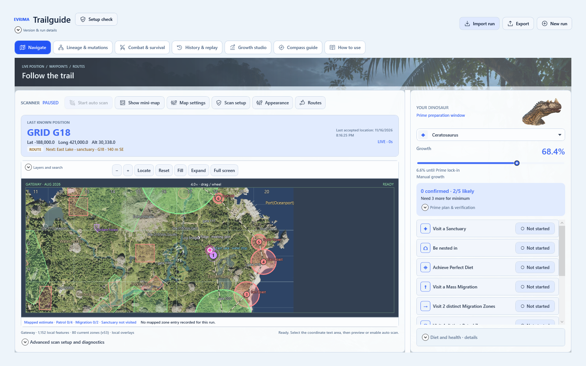
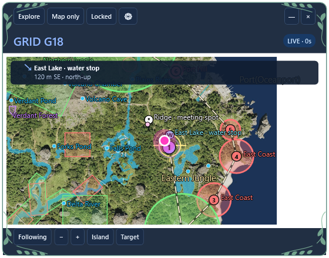
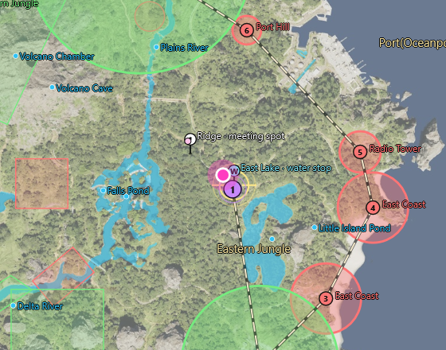
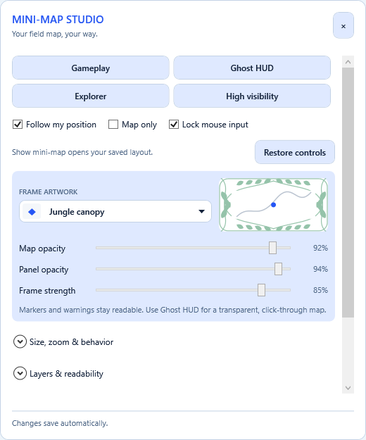
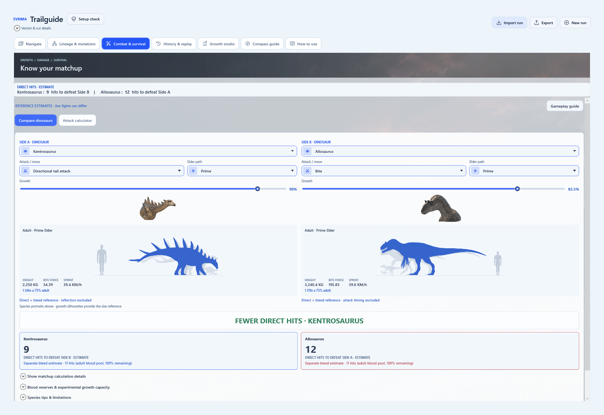
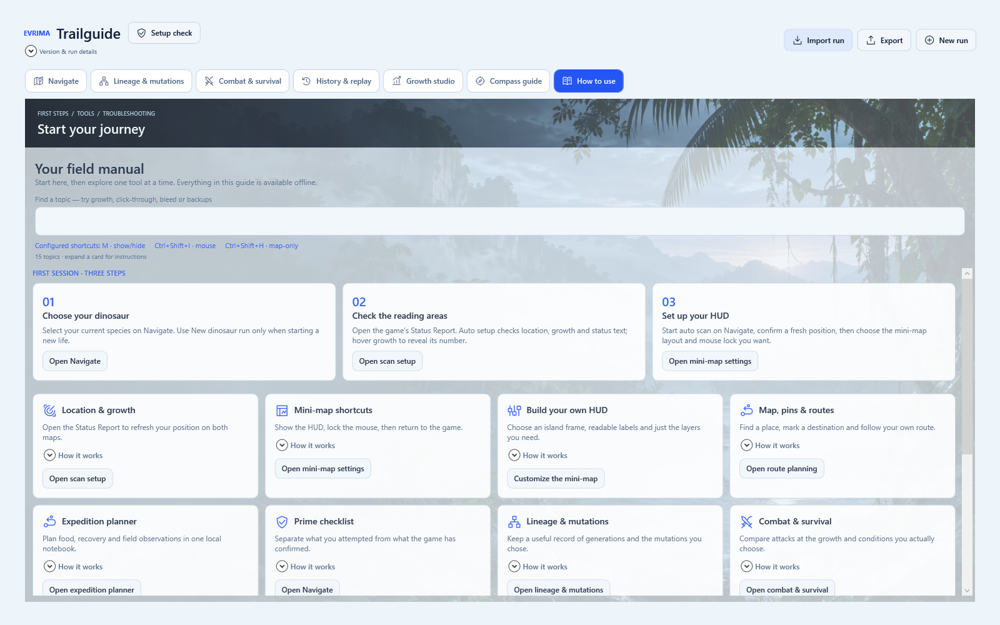

# Evrima Trailguide 1.27.0 — Mini-map Studio

**Your map. Your style. Your next move.** This stable update brings the mini-map’s controls into the main workspace, adds island-themed frames and true layered transparency, improves location reacquisition, and introduces built-in help and optional GitHub updates.

[Download the Windows installer](https://github.com/roid-apps/Evrima-Trailguide/releases/download/v1.27.0/EvrimaTrailguide-Setup-1.27.0.exe) · [Installer ZIP bundle](https://github.com/roid-apps/Evrima-Trailguide/releases/download/v1.27.0/EvrimaTrailguide-1.27.0-Windows.zip) · [Checksums](https://github.com/roid-apps/Evrima-Trailguide/releases/download/v1.27.0/SHA256SUMS.txt)

## A mini-map built around your play style

**Map settings** now sits beside **Show mini-map** on Navigate. Customize the overlay while it is hidden or visible; both settings editors use the same saved preferences.

| Compact navigation | Ghost HUD / map-only |
| --- | --- |
|  |  |

- **Six frame choices:** Glacier, Jungle canopy, Blood trail, Bone relic, Highlands and Minimal.
- **Four starting presets:** Gameplay, Ghost HUD, Explorer and High visibility.
- **Independent transparency:** terrain, panel and frame opacity can be adjusted separately. Markers, target labels and important status text remain readable.
- **Fine control:** size, zoom, follow, always-on-top, game auto-lock, zone layers, water, names, grid, label density, marker/trail colours, trail width/history and navigation cues.
- **Keep your personal layouts:** save up to eight setups for different screens or play styles. Presentation changes do not replace your active route or target.
- **Reliable recovery:** showing the map preserves map-only mode; restoring controls is an explicit action. Appearance/layout resets retain the active route, destination, shortcuts, saved layouts and placement.

<strong>See the mini-map settings</strong>

## M to show the map, with game input protected

New and reset profiles use **M** to show or hide the mini-map during focused gameplay. **Existing saved bindings remain unchanged**, including custom shortcuts and the previous Ctrl+Shift+M default. Change yours in **Map settings → Keyboard** if desired.

- Plain M works while Evrima is focused with its cursor hidden. It is suppressed around detected chat entry and continues through to the game.
- **Ctrl+Shift+I** switches mouse interaction; **Ctrl+Shift+H** switches map-only mode by default. Assign a modified show/hide shortcut if you need it in menus or chat.
- Map-only remains click-through. Auto-lock runs before showing the HUD in gameplay and rechecks when returning to Evrima.
- A failed native mouse-mode check keeps the overlay hidden. Shortcut changes are applied together; a registration failure retains the working bindings.
- Closing the overlay hides it without losing shortcut control. The main application remains the recovery path.

## Better location updates when you reopen the Status Report

This release also includes the tracking and OCR improvements developed after 1.26.0:

- Legitimate inward travel, coordinate-axis crossings and altitude changes after an unseen journey can use a faster recovery path, supported by several matching complete readings.
- Recognition has an additional native-resolution fallback for difficult bright or dim text. Conflicting coordinate readings do not silently become accepted positions.
- Capture and OCR work move off the interface thread, avoid overlapping recognition jobs and skip unnecessary capture while the OCR engine is busy recovering.
- Location scan cadence is adjustable from **0.5 to 5 seconds** without stopping and restarting the scanner. A shorter interval reduces polling wait; it is not a guaranteed end-to-end latency.
- Both map markers update directly from the accepted location, independently of breadcrumb storage. Reopening a hidden mini-map refreshes following immediately; intentional panning still pauses follow until resumed.
- New-run clearing and hidden-overlay startup preserve the right state. Unobserved travel remains a gap in route history rather than an invented continuous path.

**Coordinates must be visible.** Trailguide reads your own Status Report; it cannot track hidden movement, reveal other players or read game memory. Ambiguous OCR and implausible jumps still require confirmation. Use a tight location crop and keep Evrima focused while scanning.

## More atmosphere, less wasted space

Six decorative island scenes bring jungle rivers, fossil groves, volcanic shores, moonlit water, forest clearings and misty highlands into the workspace. Adjust artwork strength, disable scenery or choose another theme in **Appearance**.

Compact windows use shorter scenery headers, combat portraits take less vertical space, and mini-map ornaments stay on the perimeter. Search results in the new guide expand into the available space. Reduced-motion and Windows high-contrast preferences take priority over decoration.

The 22 game-referenced dinosaur portraits remain in place. Combat results remain reference estimates; this is not a new claim of exact damage or guaranteed fight outcomes.

## Help where you need it

The new **How to use** tab contains **15 searchable topics**, a three-step first-run guide, configured shortcut reminders and buttons that open the relevant controls. It works offline and covers tracking, mini-map customization, Prime, mutations, combat, replay, backups and troubleshooting.

## Optional updates that wait for you

Open **How to use → Stay up to date → Open update settings** to choose automatic updates. **Automatic downloading and installation are off by default.** Existing check-on-launch preferences do not opt you in.

- Stable releases are the default. **Include preview releases** is a separate choice.
- When enabled in an installed copy, Trailguide checks the official repository on launch and every six hours, then downloads a newer installer and verifies its release metadata, size and SHA-256.
- A ready update waits for a normal app close and successful profile save. **Close & install update** is an explicit shortcut to the same process.
- The updater waits for Trailguide to exit, rechecks the package and installation, preserves the installation location/scope, and refuses downgrades or replacement while the app has reopened.
- Downloads can be cancelled. Turning the feature off or switching channel clears the pending choice; failures are reported for review/retry. Cached installers are revalidated before use.
- It never force-closes Trailguide or your game, restarts Windows or automatically relaunches the application. Installation is not started during Windows session shutdown. All-users installs may require administrator approval.

Update checks send no run history or telemetry. The installer remains unsigned; SHA-256 verification checks the downloaded bytes against the official release and is not a code-signing certificate.

## Install or upgrade

1. Export a complete profile backup and close Trailguide.
2. Run **EvrimaTrailguide-Setup-1.27.0.exe**. Normal upgrades retain your settings, routes, history and shortcuts.
3. Open **Setup check**. Re-run **Scan setup → Auto setup** if your display or capture areas changed.
4. Open the game’s Status Report for a fresh location. Hover its growth bar to expose the numeric growth percentage.
5. Explore **Map settings** and **How to use**. Choose automatic updates only if you want them.

Windows x64, Windows 10 build 19041 or newer. The .NET runtime is included; English Windows OCR support may need enabling separately. The ZIP contains the installer and notices, **not a portable app**. GitHub’s automatic source archives contain documentation, not the private application source.

## Validation and useful limits

[Exact-build validation](https://github.com/roid-apps/Evrima-Trailguide/releases/download/v1.27.0/VALIDATION-v1.27.0.txt) records the final package checks. Review covered automated tracking/OCR regressions, mini-map state/transparency/follow behavior, seven tabs, multiple window sizes and the updater helper.

Native checks during this development cycle included the user’s physical M toggle, clicks passing through the overlay into Evrima, independent terrain/panel transparency over the game, mouse recovery and automatic locking on return. Update download verification and installation after closing Trailguide were exercised separately.

Saved-image OCR timings are not gameplay latency guarantees. The latest native overlay checks used the game’s server browser, not a fresh live-character tracking session; earlier live Status Report comparisons and current regression checks provide the recorded tracking evidence. Full detail and remaining limits are in the validation file.

Screenshots are real application renders from isolated sample profiles, not private saved runs or live gameplay. Scenery and portraits are decorative AI-assisted illustrations, not exact Gateway locations or official game renders.

[Full walkthrough](https://youtu.be/U__SdPqlwzQ) · [Quick introduction](https://youtube.com/shorts/b4B2yn6n7Ws) · [Feedback & bug reports](https://github.com/roid-apps/Evrima-Trailguide/issues)

Made by **Roid**. Independent fan project; not affiliated with The Isle’s developers.
