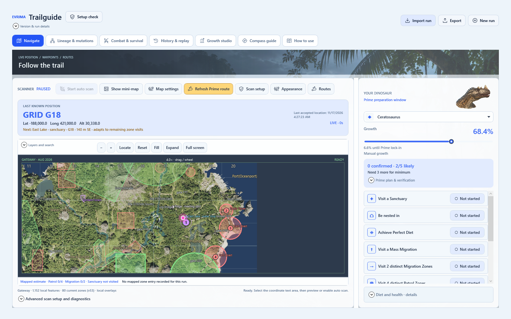
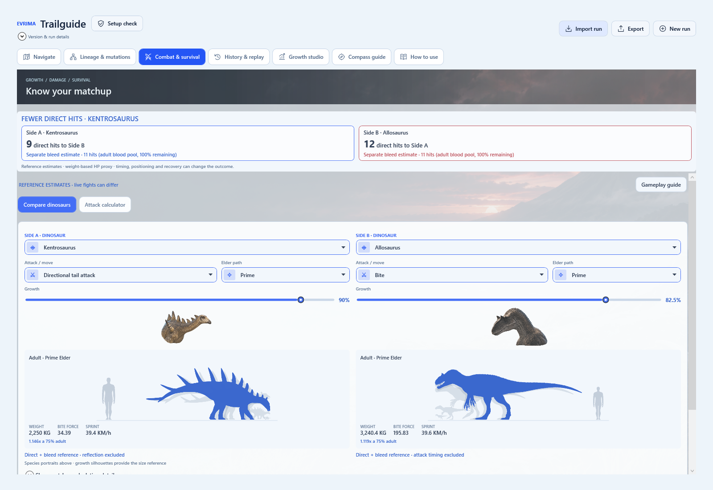
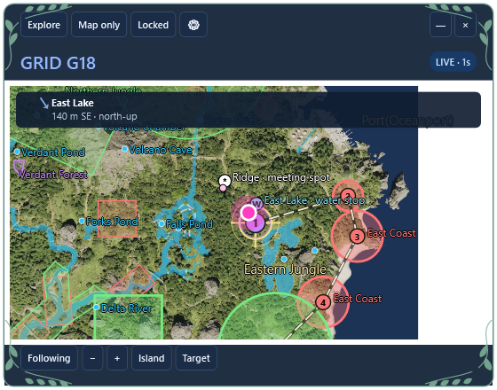
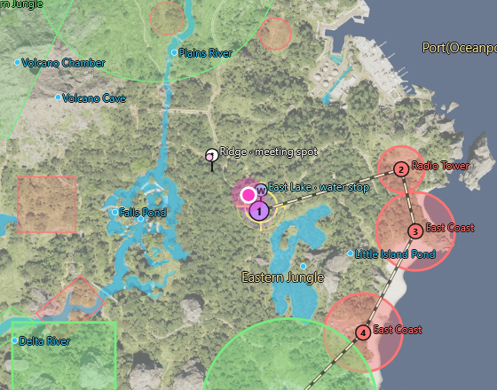
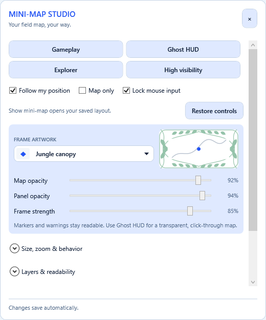
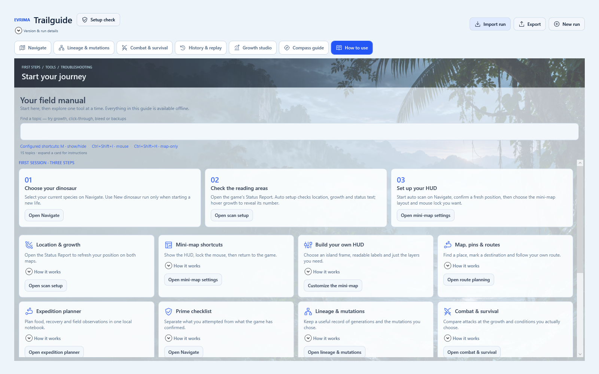

# Evrima Trailguide 1.27.1 — Tracking & Recovery

**Spawn. Plan. Explore.** This release adds one-click Prime zone planning, improves location recovery after long trips, keeps growth scanning resilient, protects imported histories and backups, and gives the map and combat results more room.

## Download for Windows

- **Recommended:** [EvrimaTrailguide-Setup-1.27.1.exe](https://github.com/roid-apps/Evrima-Trailguide/releases/download/v1.27.1/EvrimaTrailguide-Setup-1.27.1.exe)
- [Windows ZIP bundle](https://github.com/roid-apps/Evrima-Trailguide/releases/download/v1.27.1/EvrimaTrailguide-1.27.1-Windows.zip) — includes the installer and notices; this is not a portable application.
- [Checksums](https://github.com/roid-apps/Evrima-Trailguide/releases/download/v1.27.1/SHA256SUMS.txt) · [Validation report](https://github.com/roid-apps/Evrima-Trailguide/releases/download/v1.27.1/VALIDATION-v1.27.1.txt)

Windows 10 build 19041 or later, 64-bit. The runtime is included. Close Trailguide before installing; your profile and shortcuts are retained.

## A map that catches up after your journey

### One button for your next Prime stops

The highlighted **Plan my Prime route** button is directly on Navigate. Press it after spawning and open Status Report for a fresh position. If a capture area is configured, scanning starts when needed; the plan appears as soon as a valid fresh fix arrives.

The planner chooses nearby sanctuary, migration and patrol zones still needed for this run, compares useful combinations along the journey, and updates after mapped visits or changes to confirmed requirements. A meaningful detour can select closer alternatives; tiny movements do not continually shuffle your destination. Your mini-map switches to the Prime route while saved routes and pins remain available.

This is guidance through **mapped reference zones**, with straight-line distances. Trailguide cannot know which server zones are currently active or guarantee terrain-safe paths. Mapped visits remain attempts until confirmed; diet, nesting and other Prime conditions still need their own checks.

- **Verified long-travel recovery:** returning to the Status Report after traveling beyond 2 km no longer automatically falls into the old 45-second hold. The faster path requires fresh, complete, corroborated coordinates and plausible travel time.
- **Bad-reading protection stays:** missing signs, collapsed digits, stale captures and implausible jumps still receive additional checks. Unseen travel remains a gap in the recorded route.
- **Growth recovery:** a failed status-text OCR read no longer prevents the growth meter from being considered. Cancellation, game-focus and current-run checks remain in place.

Trailguide reads your own visible Status Report. Keep its coordinates visible to refresh the map. It cannot track movement while those numbers are hidden, and scan frequency is not a guaranteed update deadline.

## Safer saved runs and profile recovery

- Backup validation problems now produce actionable feedback instead of an unhandled application error.
- Restore recovery preserves the existing profile, including histories too large for the bounded JSON backup format. A failed restore has a recovery path instead of repeatedly blocking startup.
- History merges are checked before changing saved runs. Combining individually valid files can no longer silently create a run that prevents later profile saves.
- Importing a completed run can update an earlier in-progress snapshot's final growth, completion time and result. Already completed records retain conservative conflict handling.

## More room for the useful parts

- Compact layouts give the map more initial screen space, including enlarged application text/UI settings.
- Menu tabs keep their visual order when you switch sections.
- Combat puts the paired direct-hit and bleed estimates before the largest artwork.
- Combat, mutation, replay and growth selectors have clearer screen-reader labels.

Combat values remain reference estimates. This release improves reliability and presentation; it does not introduce newly certified damage values or guarantee a fight outcome.

## Your Mini-map Studio is still here

| Compact companion | Transparent Ghost HUD |
| --- | --- |
|  |  |

Keep your frame style, terrain/panel/frame transparency, follow mode, layers, trail colours, saved layouts and configured shortcuts. **Map settings** beside **Show mini-map** works even while the overlay is hidden. Existing users keep their current bindings; **M** is the new-profile show/hide default.

Mini-map settings and built-in help

All screenshots show actual application controls with an isolated sample profile. Coordinates and growth are sample inputs, not a live tracking demonstration. Portraits and scenery are decorative illustrations based on game references.

## Updating and getting started

Automatic updating remains **opt-in**. Open **Appearance → Updates, backups & support**, or use **How to use → Open update settings**, to download verified GitHub updates and install them after a normal close. Stable releases are the default; preview updates are a separate choice. Updates do not force-close your game or restart Windows.

New to Trailguide? Open **How to use** for setup, tracking, mini-map controls, Prime objectives, mutations, combat, replay and recovery guidance. [Watch the walkthrough](https://youtu.be/U__SdPqlwzQ).

The installer is unsigned, so Windows may display an unknown-publisher/reputation warning. Use the official release downloads above; checksums verify the downloaded bytes against the published package.

If a reading stalls, a useful report includes the Trailguide version, whether the Status Report stayed visible, display scale, selected capture region and any diagnostic message. Please avoid posting private server or personal details. Your feedback helps target the next improvements.
