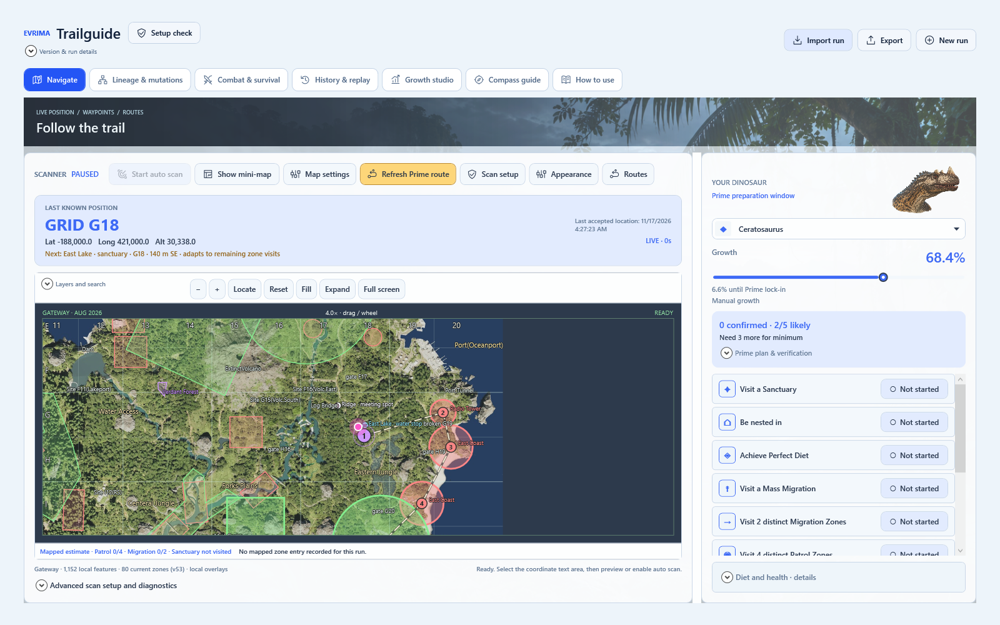
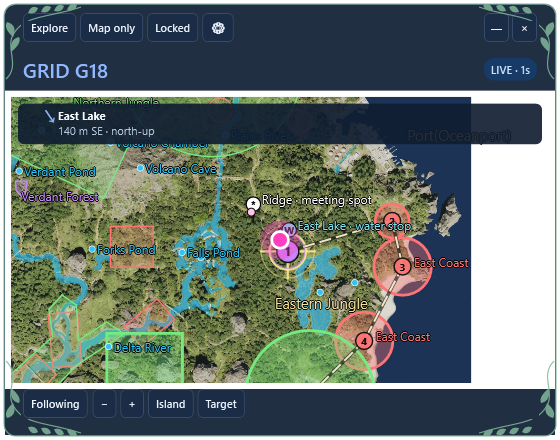

# Evrima Trailguide 1.27.2 — Stay on the Right Trail

**The right route. The right dinosaur life.** This update keeps Prime navigation and mini-map controls in sync, makes stale location guidance clearer, and helps prevent yesterday’s progress from being reused for a new dinosaur.

## Download for Windows

- **Recommended:** [EvrimaTrailguide-Setup-1.27.2.exe](https://github.com/roid-apps/Evrima-Trailguide/releases/download/v1.27.2/EvrimaTrailguide-Setup-1.27.2.exe)
- [Windows ZIP bundle](https://github.com/roid-apps/Evrima-Trailguide/releases/download/v1.27.2/EvrimaTrailguide-1.27.2-Windows.zip) — includes the installer and notices; this is not a portable application.
- [Checksums](https://github.com/roid-apps/Evrima-Trailguide/releases/download/v1.27.2/SHA256SUMS.txt) · [Validation report](https://github.com/roid-apps/Evrima-Trailguide/releases/download/v1.27.2/VALIDATION-v1.27.2.txt)

Windows 10 build 19041 or later, 64-bit. The runtime is included. Close Trailguide before installing; normal upgrades retain your profile and shortcuts.

## One destination across both maps

Switching from a personal itinerary to **Plan my Prime route** now updates the mini-map’s destination selector, target, route progress and pause controls together. Old itinerary controls no longer linger after the navigation mode changes. Saved pins and route presets remain available, and changing appearance does not reset navigation.

When your position becomes stale, the main map now keeps the next destination visible while pausing distance and direction until a fresh reading arrives. This matches the mini-map’s behavior and makes it clearer when to reopen Status Report.

| Your navigation workspace | Your in-game companion |
| --- | --- |
|  |  |

These representative screenshots are from 1.27.1 and show actual application controls with an isolated sample profile. The existing themes, artwork, overlay customization and one-click Prime planning remain included.

## A fresh life deserves a fresh plan

Resuming Trailguide with substantially lower growth can mean you are playing a different dinosaur life. Repeated matching readings now bring up a small **Check dinosaur life** card with two choices:

- **Start new life:** archive the saved life before clearing its progress and preparing the new run. If archiving fails, the existing run stays intact.
- **Keep this life:** keep your run and objectives, accept the corrected growth, and continue planning.

The map marker continues to update during this check, while automatic progress recording and planning from inherited zone visits wait for your choice. Stale or duplicate readings cannot confirm the change. Manual edits survive closing and reopening, and the route view waits for the decision before fitting the new plan.

Growth cannot identify every new life. After death, respawning or switching lives, **New run** remains the reliable starting point—especially when the new dinosaur has similar or higher growth. The built-in **How to use** guide now explains this workflow.

## Cleaner route history

- Observations held during a life check preserve a gap in the travel trail instead of drawing a false connection.
- Exporting during a life check no longer attaches the new position to the previous life’s history.
- Exporting immediately after **Keep this life** also preserves the pending travel gap.

## Reference details without covering the map

The data-pack tooltip now shows a compact, wrapped summary in your selected theme. Compatibility warnings remain visible, with the full reference notes available under **Setup check → Versioned data pack**.

## Tracking and validation

During the live review leading to this update, the user confirmed that Status Report coordinates matched, both map markers updated promptly after movement, a fresh Prime route appeared on both maps, and entering a needed migration zone advanced the route correctly. Automated regression and layout checks cover the new safeguards; the [build-specific validation report](https://github.com/roid-apps/Evrima-Trailguide/releases/download/v1.27.2/VALIDATION-v1.27.2.txt) records the final results and testing limits.

Trailguide reads **your own visible Status Report**. Open it to refresh your location; hidden coordinates cannot be tracked. Prime routes use mapped reference zones and straight-line distances, not guaranteed terrain-safe paths or live server-zone state. Mapped visits remain attempts until verified in game, and diet, nesting and other Prime conditions still need their own checks.

## Updating and getting started

Automatic updating remains **opt-in**, with stable releases selected by default. Open **How to use → Stay up to date → Open update settings**, or install the package above. Existing themes, mini-map preferences and saved shortcuts are retained.

The installer is unsigned. An unfamiliar-app or SmartScreen reputation warning is not itself a malware detection. Use the official release downloads and keep Windows protection enabled; published checksums let you verify the downloaded package.

[Watch the walkthrough](https://youtu.be/U__SdPqlwzQ) · [Report an issue or share feedback](https://github.com/roid-apps/Evrima-Trailguide/issues)

If tracking stalls, include your Trailguide version, whether Status Report remained visible, display scale, capture setup and the diagnostic message. Avoid posting private server or personal details.
