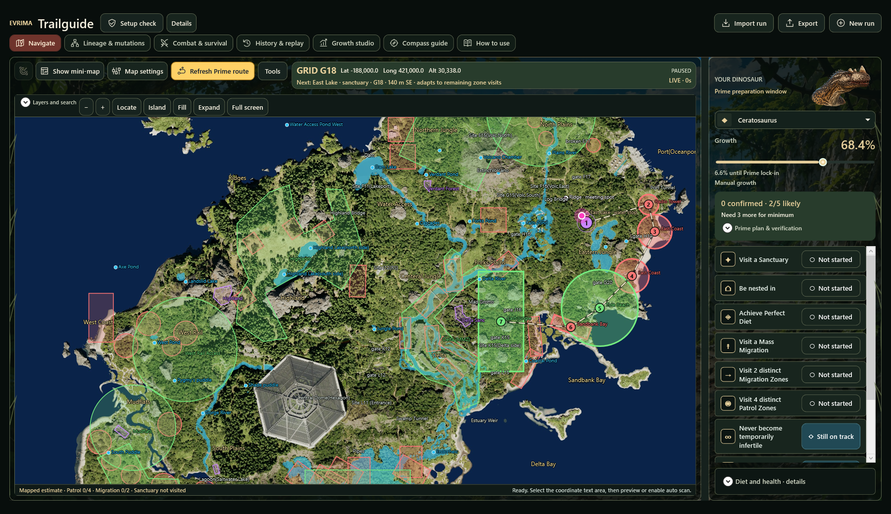
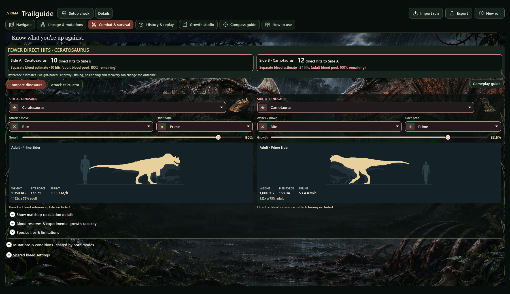
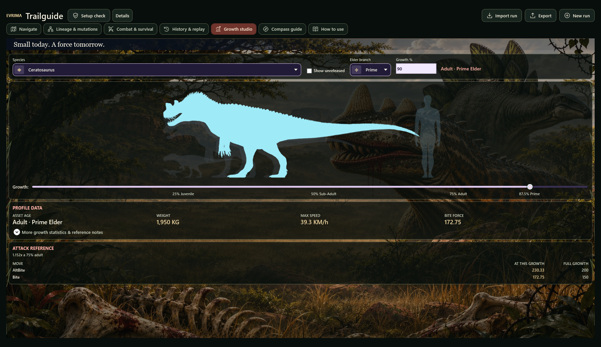
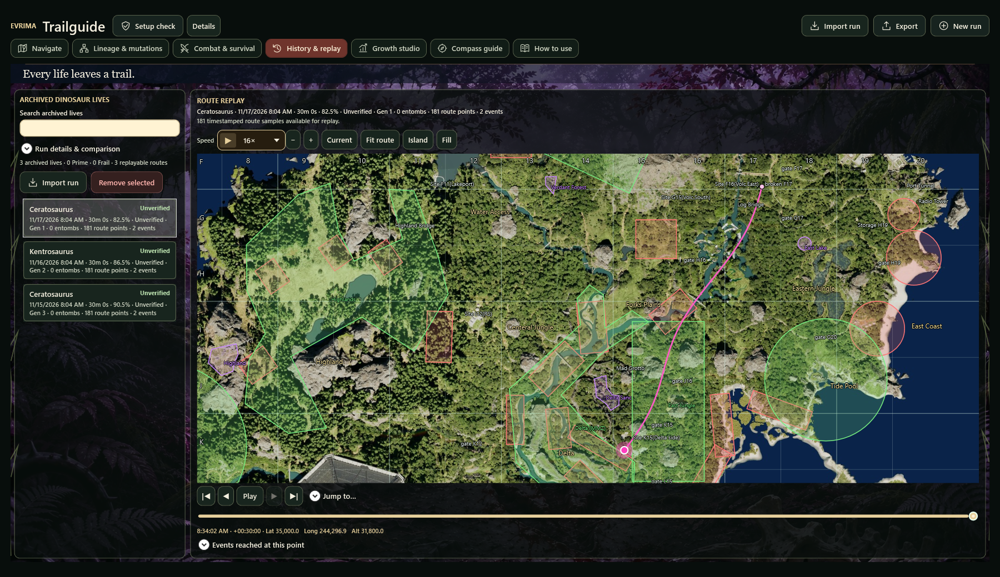
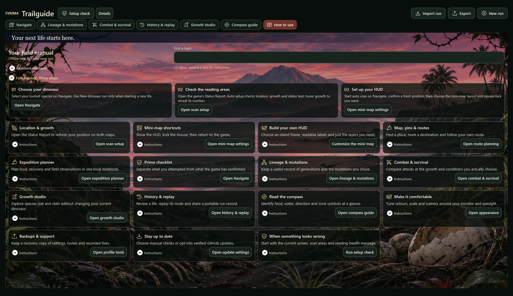
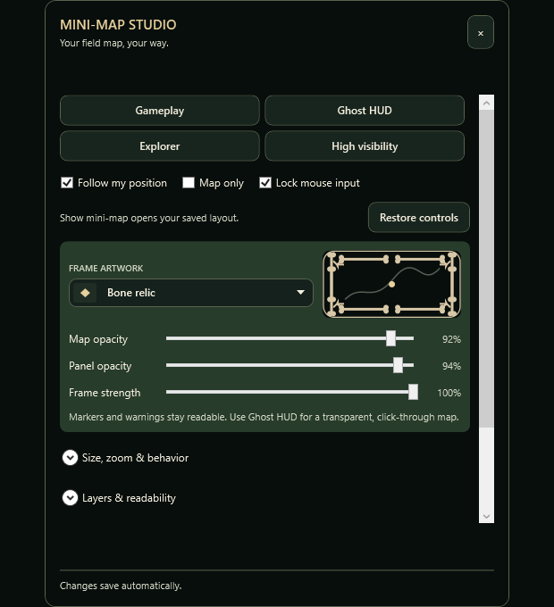
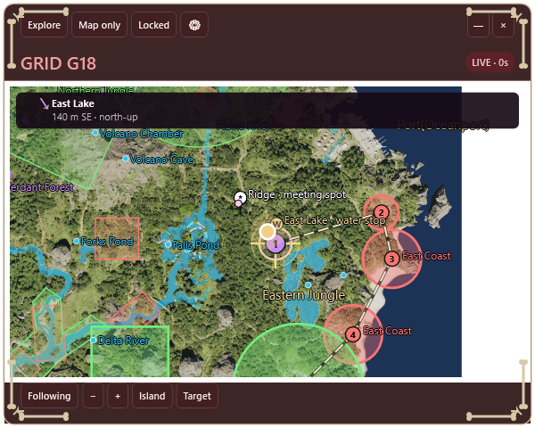
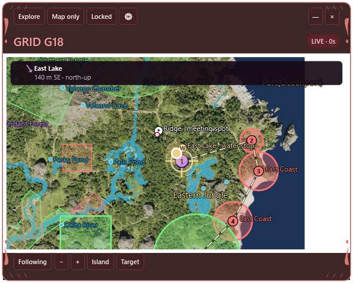
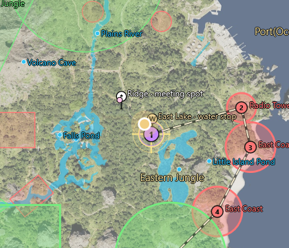

# Evrima Trailguide 1.28.0 — Primal Scenery, Bigger Maps and Tracking Repairs

**More of the island on screen, with clearer tools for surviving it.** Version 1.28.0 adds optional Primal scenery, makes the map the centerpiece of Navigate, and repairs OCR failures that could leave both maps on an old position even while Status Report was visible.

## Download for Windows

- **Recommended:** [EvrimaTrailguide-Setup-1.28.0.exe](https://github.com/roid-apps/Evrima-Trailguide/releases/download/v1.28.0/EvrimaTrailguide-Setup-1.28.0.exe)
- [Windows ZIP bundle](https://github.com/roid-apps/Evrima-Trailguide/releases/download/v1.28.0/EvrimaTrailguide-1.28.0-Windows.zip) — contains the installer and notices; it is not a portable application.
- [Checksums](https://github.com/roid-apps/Evrima-Trailguide/releases/download/v1.28.0/SHA256SUMS.txt) · [Validation report](https://github.com/roid-apps/Evrima-Trailguide/releases/download/v1.28.0/VALIDATION-v1.28.0.txt)

Windows 10 build 19041 or later, 64-bit. The runtime is included. Close Trailguide before installing; normal upgrades retain your profile and shortcuts.

## Optional Primal scenery

Choose **Navigate → Tools → Appearance → Primal · blood & bones** for darker survival scenery: bloodied dinosaurs, bones, jungle mountains, storm combat, misty forests, dry growth habitats, a moonlit coast and volcanic dawn. Scenes change across the tabs, with adjustable artwork strength, translucent panels, optional vine and thorn borders, and gentle motion.

- Panel opacity adjusts from **70–100%**, so you can balance scenery and readability.
- Decorative edges do not intercept clicks or cover the working map.
- High contrast disables scenery, and reduced motion stops the decorative transitions.
- Primal is **opt-in**. Classic and your saved color palette remain available; changing the style preserves your navigation and mini-map settings.

| Combat and survival | Growth studio |
| --- | --- |
|  |  |

Screenshots show actual stable 1.28.0 controls with an isolated sample profile and Primal scenery. Coordinates, routes and archives are illustrative inputs, not proof of live tracking during capture. The scenic illustrations are decorative artwork, not live game footage or evidence of dinosaur statistics.

## A larger map and less clutter

Navigate now starts with terrain filling the map viewport, instead of a small island surrounded by wide black margins. **Island** shows the whole map; **Fill** fills the viewport again. The default layout gives more width to the map, while customized panel splits and later camera choices are retained.

The app header, navigation controls, position display and map footer are more compact. **Details**, **Tools** and **Scan setup** keep the longer explanations and diagnostics close by. At narrow window sizes, **Dinosaur panel** reveals the sidebar when needed; a pending life check keeps its own visible action.

The other tabs also give priority to inputs, imagery and results:

- **Lineage:** a narrower summary, compact search, readable mutation slots and a cleaner ledger.
- **Combat:** pinned direct/bleed estimates, portraits beside species selectors, grouped attack controls and expandable bleed details.
- **History:** more room for the replay map. Selecting a run frames its complete route; playback, resizing and revisiting the tab preserve later manual zoom and pan.
- **Growth:** artwork adapts to the available height while the main controls and statistics stay prominent.
- **Compass:** icons, names and meanings stay visible; **Show descriptions** reveals the longer notes.
- **How to use:** a smaller search header, expandable shortcut details and actions beside the instructions they open.

<strong>Explore Primal History and How to use</strong>

## Tracking repairs

Several separate problems could make growth update while location stayed stale. This release repairs the automatic coordinate crop and improves recognition of the glowing Status Report labels. Existing automatic presets upgrade where needed; custom capture areas are preserved.

After unseen travel, consistent verified coordinates can reacquire your position without an unnecessary long hold. Missing signs, suspicious decimal shifts, conflicting readings, stale captures and implausible positions still receive validation. Reacquisition starts a new trail segment instead of drawing a path across movement the app did not observe.

Additional fixes:

- Capture checks the game window and focus around the actual screen copy, preventing a window change from becoming live evidence.
- Delayed Status Report readings cannot update diet objectives or combat evidence as though they were fresh.
- Altitude checks and horizontal-jump checks no longer share unrelated confirmation time.
- Future-dated saved samples cannot become the active marker or block current tracking; archived history is retained.
- The mini-map's confirmation badge and message agree while the last accepted marker remains in place.

Trailguide reads **your own visible Status Report**. Open it with complete Lat/Long/Alt labels and values visible to refresh your position. Hidden coordinates cannot be tracked. Recorded-image Windows OCR and reacquisition checks exercise the repaired workflow; they are not a guarantee of live latency on every machine.

## Mini-map and route polish

Pins and routes now redraw immediately when edited while your dinosaur is stationary. **Previous stop** also moves backward correctly when a saved route contains deleted pins. Existing show/hide shortcuts, click-through, transparency and mini-map customization remain available.

| Mini-map appearance controls | Bone relic mini-map |
| --- | --- |
|  |  |

The mini-map shown uses the existing **Bone relic** frame with customized warm colours, a gold marker and a muted red trail. Frame selection and colours are separate settings in 1.28.0, so you can pair the overlay with your Primal workspace.

<strong>See the Blood trail frame and map-only Ghost HUD</strong>

**Blood trail** supplies crimson edge details. This sample uses the same customized colours as Bone relic.

**Ghost HUD** hides the frame and controls for a transparent, click-through map-only view. These sample-profile renders are not composited over gameplay.

Prime routes use mapped reference zones and straight-line distances. They do not expose live server-zone flags or guarantee a terrain-safe path; mapped visits remain attempts until verified in game.

## Reference review and validation

Public metadata was reviewed on **18 November 2026**. The public ruleset remains **0.21.772**, build **24664737**. HordeTest announcements remain separate from public rules. Detailed metadata now records the source-review date and links, while historical diet, growth and combat references retain their own version warnings. A matching installed build is described as a match, rather than blanket verification of every mechanic.

The [validation report](https://github.com/roid-apps/Evrima-Trailguide/releases/download/v1.28.0/VALIDATION-v1.28.0.txt) records the stable build's regression, layout, OCR, mini-map and installation checks, with their limits. The theme and layout review includes small windows and 125% UI scaling. No new physical in-game M-key or click-through test is claimed for this packaging pass.

Automatic updates remain **opt-in**, with stable releases selected by default. Use **How to use → Stay up to date → Open update settings**, or install the package above.

[Watch the walkthrough](https://youtu.be/U__SdPqlwzQ) · [Report an issue or share feedback](https://github.com/roid-apps/Evrima-Trailguide/issues)

For tracking reports, include the app version, whether Status Report stayed visible, display scale, capture setup and the diagnostic message. Avoid sharing private server or personal details.
