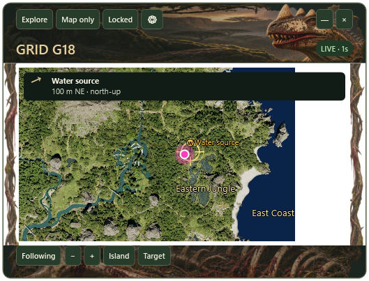
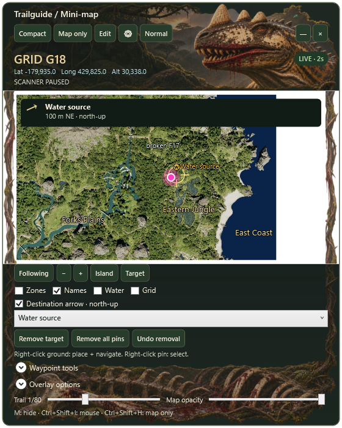

# Evrima Trailguide 1.28.1 — A Cinematic Primal Mini-map

**Take the atmosphere of the island back into the game.** Version 1.28.1 adds a dedicated **Primal · blood & bones** mini-map frame: a bloodied Ceratosaurus, dark jungle scenery, weathered skeletal remains and vines surrounding all four sides of the overlay.

## Download for Windows

- **Recommended:** [EvrimaTrailguide-Setup-1.28.1.exe](https://github.com/roid-apps/Evrima-Trailguide/releases/download/v1.28.1/EvrimaTrailguide-Setup-1.28.1.exe)
- [Windows ZIP bundle](https://github.com/roid-apps/Evrima-Trailguide/releases/download/v1.28.1/EvrimaTrailguide-1.28.1-Windows.zip) — contains the installer and notices; it is not a portable application.
- [SHA-256 checksums](https://github.com/roid-apps/Evrima-Trailguide/releases/download/v1.28.1/SHA256SUMS.txt) · [Validation report](https://github.com/roid-apps/Evrima-Trailguide/releases/download/v1.28.1/VALIDATION-v1.28.1.txt)

Windows 10 build 19041 or later, 64-bit. The .NET runtime is included. Close Trailguide before installing; normal upgrades retain your profile and shortcuts. Keep a profile backup before upgrading.

## Choose the Primal frame

Open **Navigate → Map settings → Frame artwork → Primal · blood & bones**. The frame is a separate choice from the main app's Primal scenery, so existing layouts retain their selected appearance.

- **Artwork on every edge:** the jungle and dinosaur span the header, skeletal remains fill the footer, and narrow vine borders run down both sides outside the terrain.
- **Compact or expanded:** the frame adapts to the window while the dinosaur and bone details retain their proportions.
- **Readable controls:** dark green panels, warm bone-coloured text and shaded artwork keep the location, navigation target and controls distinct.
- **Your opacity settings:** terrain, panels and frame artwork remain independently adjustable. Map-only mode removes the decorative chrome, and high contrast hides the artwork.

The existing frames, Gameplay and Ghost HUD presets, named layouts, mouse locking and recovery shortcuts remain available. The artwork is decorative and does not receive mouse or keyboard input.

## Included from 1.28.0

This update focuses on the mini-map's appearance. It includes the [1.28.0 improvements](https://github.com/roid-apps/Evrima-Trailguide/releases/tag/v1.28.0): optional Primal scenery across the main workspaces, a larger navigation map, compact controls, stronger coordinate reacquisition, immediate pin and route redraws, and improved replay framing.

Main workspace scenery remains available under **Navigate → Tools → Appearance → Primal · blood & bones**, with controls for scenery strength, panel opacity, edge details and motion.

Trailguide reads **your own visible Status Report**. Hidden coordinates cannot be tracked. Routes use mapped reference zones and straight-line distances, not live server-zone flags or guaranteed safe paths. Mapped visits remain attempts until verified in game.

## Screenshots and validation

The screenshots render actual application controls with isolated sample positions. They are not live gameplay captures or proof of tracking during the capture session. The cinematic dinosaur, jungle and skeletal scenery are decorative AI-assisted artwork.

See the [build-specific validation report](https://github.com/roid-apps/Evrima-Trailguide/releases/download/v1.28.1/VALIDATION-v1.28.1.txt) for the release checks and their limits.

Automatic updates remain **opt-in**, with stable releases selected by default. Use **How to use → Stay up to date → Open update settings**, or install the package above.

[Watch the walkthrough](https://youtu.be/U__SdPqlwzQ) · [Report an issue or share feedback](https://github.com/roid-apps/Evrima-Trailguide/issues)

For tracking reports, include the app version, whether Status Report stayed visible, display scale, capture setup and the diagnostic message. Avoid sharing private server or personal details.
