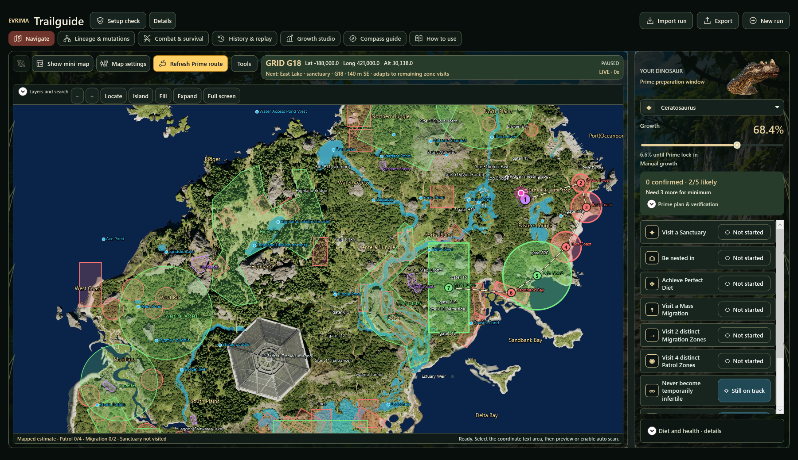
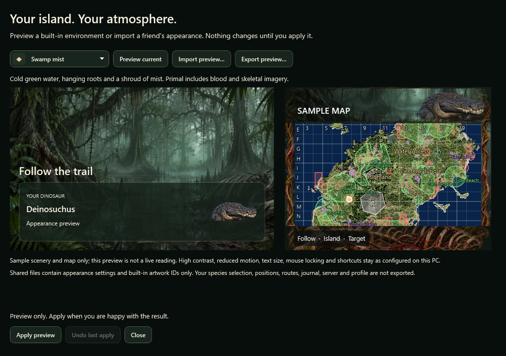
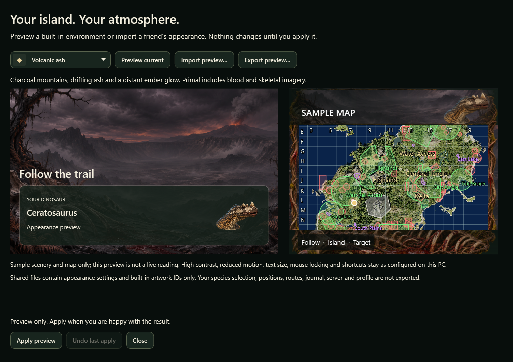
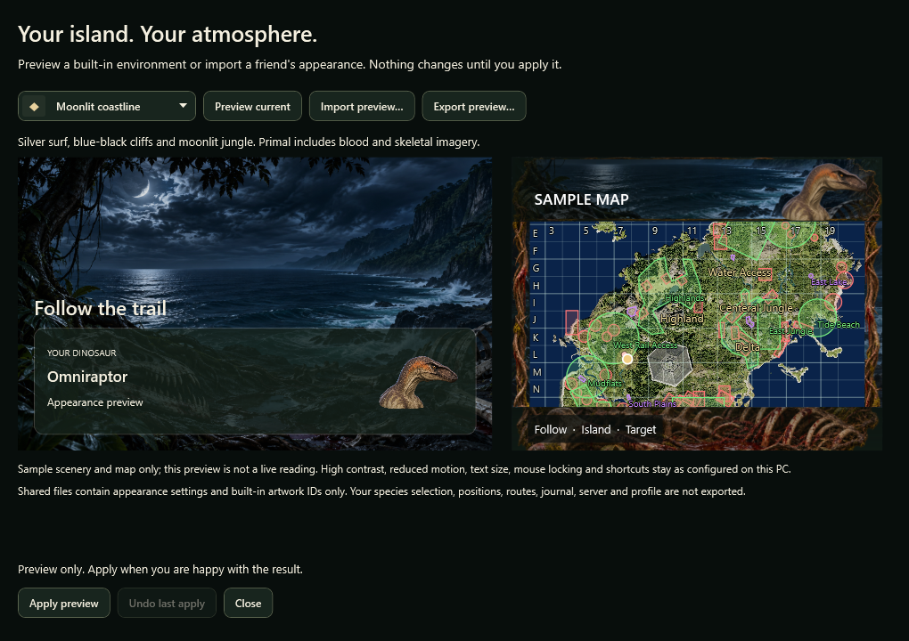
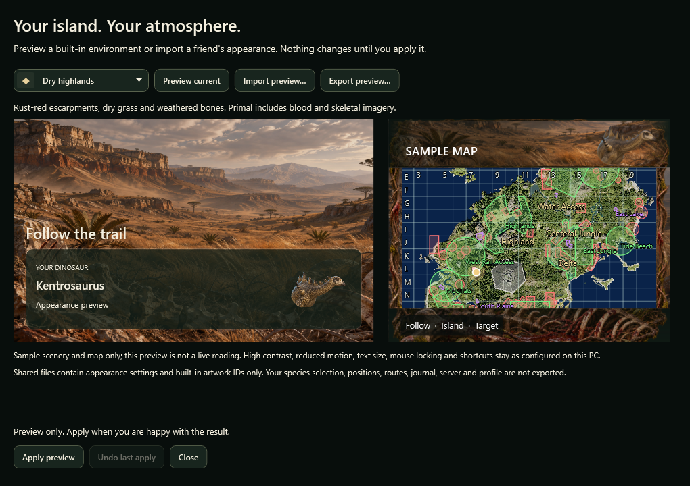
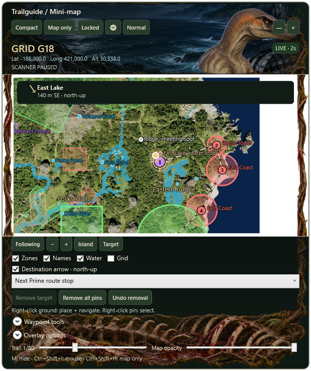
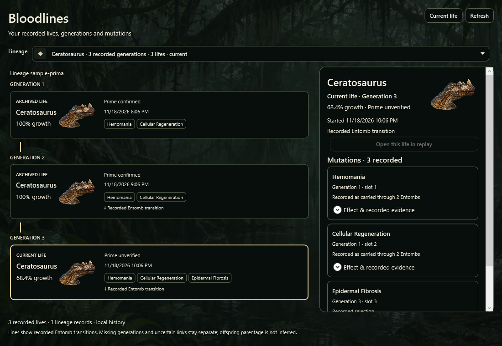

# Evrima Trailguide 1.29.0 — Primal Habitats & Bloodlines

**Your dinosaur. Your atmosphere. Every recorded life.** Stable **1.29.0** adds four Primal environment packs, species artwork for the full-wrap mini-map, a visual lineage tree, and shareable appearance presets with preview and undo.

## Download for Windows

- **Recommended:** [EvrimaTrailguide-Setup-1.29.0.exe](https://github.com/roid-apps/Evrima-Trailguide/releases/download/v1.29.0/EvrimaTrailguide-Setup-1.29.0.exe)
- [Windows ZIP bundle](https://github.com/roid-apps/Evrima-Trailguide/releases/download/v1.29.0/EvrimaTrailguide-1.29.0-Windows.zip) — contains the installer and notices; it is not a portable application.
- [SHA-256 checksums](https://github.com/roid-apps/Evrima-Trailguide/releases/download/v1.29.0/SHA256SUMS.txt) · [Validation report](https://github.com/roid-apps/Evrima-Trailguide/releases/download/v1.29.0/VALIDATION-v1.29.0.txt)

Windows 10 build 19041 or later, 64-bit. The .NET runtime is included. Close Trailguide before installing; normal upgrades retain your saved profile, appearance and shortcuts. Keep a profile backup before upgrading.

## 🌿 Four habitats, four different moods

Choose **Navigate → Tools → Appearance → Primal · blood & bones**, then select an **Environment**:

<table>
  <tr>
    <td width="50%"> <strong>Swamp mist</strong> Cold green water, hanging roots and mist.</td>
    <td width="50%"> <strong>Volcanic ash</strong> Charcoal mountains, ash and a distant ember glow.</td>
  </tr>
  <tr>
    <td width="50%"> <strong>Moonlit coastline</strong> Silver surf, blue-black cliffs and moonlit jungle.</td>
    <td width="50%"> <strong>Dry highlands</strong> Rust-red escarpments, dry grass and weathered bones.</td>
  </tr>
</table>

**Original** keeps the existing scene for each tab. Scenery strength, panel opacity, decorative edges and motion remain adjustable. Existing preferences are preserved, and Primal remains optional.

These are manually chosen artistic environments. They do not detect your current biome or in-game weather, and they do not replace the geographic map.

## 🦕 A Primal mini-map for your dinosaur

The full-wrap Primal frame now supports the selected dinosaur using the app’s **22 existing game-reference-based portraits**. Choose a habitat behind the portrait while vines and skeletal artwork continue around all four edges.

Open **Navigate → Map settings → Frame artwork → Primal · blood & bones**, then enable **Feature my dinosaur on the Primal mini-map** in Appearance or Map settings. Turn personalization off and choose Original to restore the original cinematic frame.

- Artwork remains outside the working map and receives no mouse or keyboard input.
- Terrain, panel and frame opacity remain independently adjustable.
- Map-only mode hides ornament; High Contrast removes decorative artwork.
- Your location, zoom, route, mouse lock and shortcuts stay independent of appearance.

The frame remains a separate choice from the main app’s Primal scenery. Existing layouts keep their selected look until you change it.

## 🧬 Bloodlines: recorded lives, generations and mutations

Open **Lineage & mutations → Explore lineage tree**. Choose a recorded lineage, select a life to inspect its mutations, or jump into that archived life’s route replay. Compact generation cards use the available width; details sit beside the tree on larger windows and below it on smaller ones.

Connections require **recorded Entomb evidence**. Missing generations, ambiguous transitions and legacy records remain separate. Bloodlines shows recorded continuity; it does not infer biological parentage or invent mutation inheritance values.

## 🎨 Share a look, preview it, undo it

Open **Navigate → Tools → Appearance → Appearance presets**:

1. Choose an environment or **Import preview…** from a shared appearance file.
2. Inspect the scene and mini-map together. Nothing is applied while you browse.
3. Choose **Apply preview** to save the look, or close the window to keep your current appearance.
4. Use **Undo last apply** to restore the previous appearance while preserving newer navigation progress.

**Export preview…** shares appearance settings and bundled artwork IDs. Species selection, coordinates, routes, run history, server information, hotkeys and window placement are excluded. Applying a preset keeps your local accessibility, motion and keybind choices. Unsupported files and external artwork paths are rejected.

## Fixes and polish

- Open mini-maps and appearance previews now refresh when Windows High Contrast changes; decorations, opacity and map margins update together.
- Appearance previews respond to species and relevant readability changes while preserving the pending imported look.
- Camera movement, route progress and window-position changes no longer rebuild an open appearance preview.
- Preview and lineage listeners detach when their windows close, and queued refreshes cannot repaint a closed window.
- Reapplying the same preview keeps the useful undo state. Undo preserves newer route and camera changes and independently chosen accessibility settings.
- Unknown dinosaur artwork does not substitute an unrelated species. Existing original Primal artwork remains available.
- Offline help includes the new environments, Bloodlines and appearance presets.

## Compatibility and validation

This release keeps the existing tracking, Prime route planning, compact workspaces and full-wrap overlay behavior. It does not introduce a new coordinate-tracking algorithm or change game reference values.

Trailguide reads **your own visible Status Report**. Hidden coordinates cannot be tracked. Routes use mapped reference zones and straight-line distances, not live server-zone flags or guaranteed safe paths. Mapped visits remain attempts until verified in game.

The screenshots show actual stable 1.29.0 controls rendered with isolated sample profiles and positions. The environments and portraits are decorative AI-assisted artwork; the screenshots are not live gameplay captures.

Automated and headless checks cover the four habitats, all 22 portraits, map geometry and camera preservation, map-only and High Contrast modes, appearance sharing and the lineage tree. See the [build-specific validation report](https://github.com/roid-apps/Evrima-Trailguide/releases/download/v1.29.0/VALIDATION-v1.29.0.txt) for exact results and limits. Physical in-game input testing was not repeated for this appearance release.

Automatic updates remain **opt-in**, with stable releases selected by default. Use **How to use → Stay up to date → Open update settings**, or install the package above.

[Watch the walkthrough](https://youtu.be/U__SdPqlwzQ) · [Report an issue or share feedback](https://github.com/roid-apps/Evrima-Trailguide/issues)
