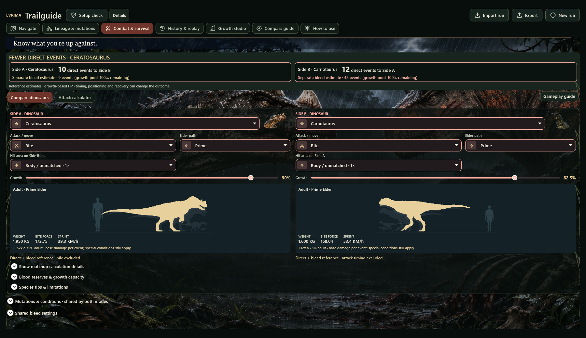
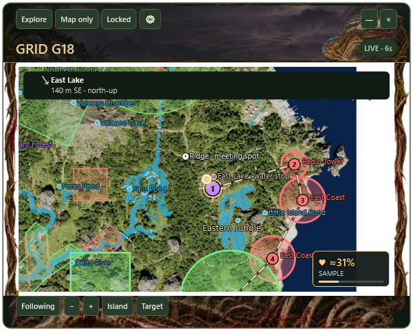
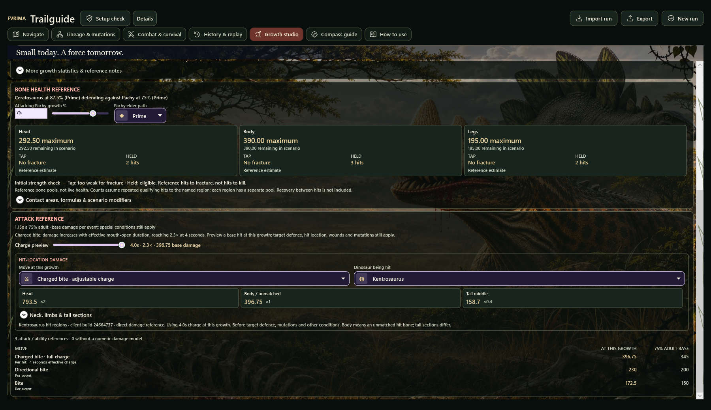
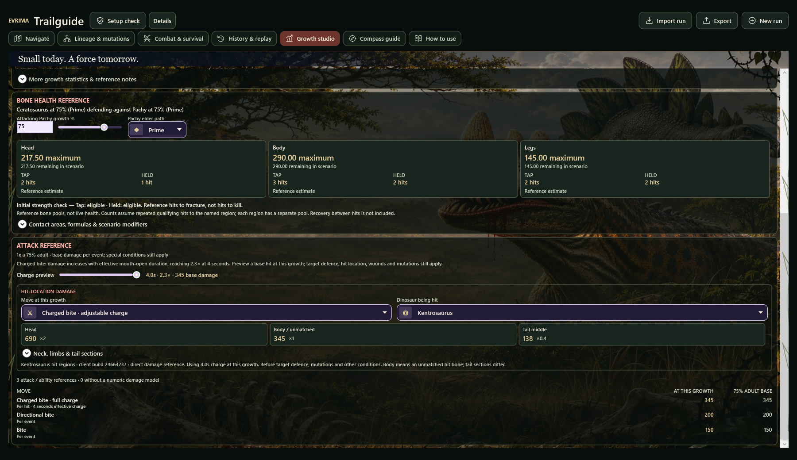
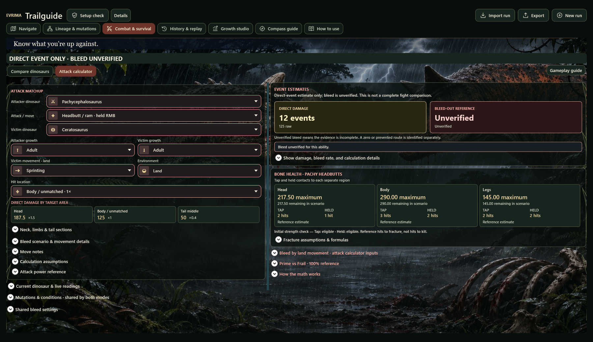
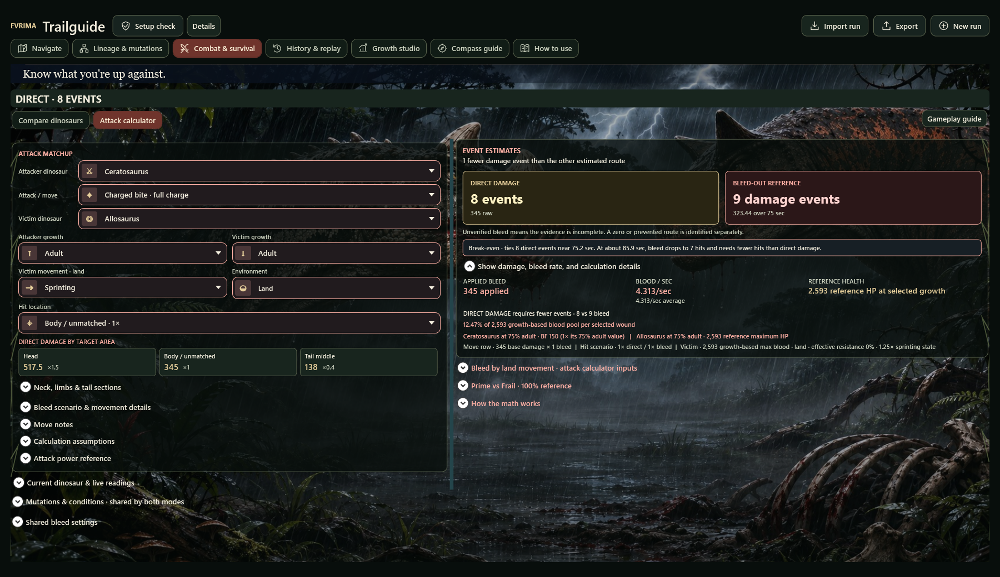

# Evrima Trailguide 1.29.1 — Health, Hits & Broken Bones

**Know what a hit can do.** Stable **1.29.1** adds an approximate mini-map health indicator, deeper attack and growth references, target-specific hit regions, Pachy fracture calculations and corrected bleed scenarios. Your Primal environments, personalized full-wrap mini-map, Bloodlines tree and appearance presets remain part of the experience.

## Download for Windows

- **Recommended:** [EvrimaTrailguide-Setup-1.29.1.exe](https://github.com/roid-apps/Evrima-Trailguide/releases/download/v1.29.1/EvrimaTrailguide-Setup-1.29.1.exe)
- [Windows ZIP bundle](https://github.com/roid-apps/Evrima-Trailguide/releases/download/v1.29.1/EvrimaTrailguide-1.29.1-Windows.zip) — contains the installer and notices; it is not a portable application.
- [SHA-256 checksums](https://github.com/roid-apps/Evrima-Trailguide/releases/download/v1.29.1/SHA256SUMS.txt) · [Validation report](https://github.com/roid-apps/Evrima-Trailguide/releases/download/v1.29.1/VALIDATION-v1.29.1.txt)

Windows 10 build 19041 or later, 64-bit. The .NET runtime is included. Close Trailguide before installing; normal upgrades retain your profile, appearance and shortcuts. Keep a profile backup before upgrading.

## ❤️ A small wounded-health indicator

The mini-map’s **bottom-right corner** can now show an approximate health reading from a matched visible Status Report and recent growth. It follows the selected dinosaur and qualified growth/Elder reference. Toggle **Navigate → Map settings → Health estimate · bottom right** to show or hide it.

- Above half health, the indicator shows a range rather than claiming an exact percentage.
- Readings become **STALE** after eight seconds. Damage and recovery are not predicted while Status Report is closed.
- Missing, contradictory or mismatched evidence stays unavailable. A species change, new life or restart clears the observation.
- The indicator adds no separate capture loop and preserves click-through behavior. It works with map-only layouts and High Contrast.

This is an experimental estimate, not measured HP. Diet, mutations, server settings and game updates can affect it. The screenshot is explicitly marked **SAMPLE**; it is not a live wounded-character validation.

## 🦕 Attacks that follow growth and the target

Attack coverage and scaling have been reviewed across all **22 released species**, alongside the four unreleased reference entries. Growth Studio presents readable move names, growth and Prime/Frail scaling, event units and special conditions. Unverified abilities remain visible without fabricated damage or hit counts.

- **Ceratosaurus charged bite:** preview **0–4 effective mouth-open seconds**. The recovered reference increases from ordinary bite power to **2.3× at full charge**, before target and scenario adjustments.
- Added or clarified Pachy tap/held headbutts, Troodon venom-stage contacts, Dilophosaurus individual hallucination hits and Omniraptor primary/secondary latch cycles. A single event is not the total damage of a pounce or summon.
- Corrected Pteranodon’s directional reference and removed outdated Dryosaurus directional bleed.
- Choose a **target dinosaur and hit area** in Growth Studio, the attack calculator and both sides of a matchup. Head, body, neck, limbs and tail sections use the target’s qualified profile. Special attacks that bypass ordinary region scaling retain their separate rules.

Some conditional damage remains unresolved, including Carno’s continuous headbutt curve, Rex throw damage, Hypsi spit scaling and whole hallucination/venom sequences. These do not become invented numeric predictions.

## 🦴 Bone health and Pachy fracture calculations

Open **Growth Studio → Bone health reference** to inspect **Head / Body / Legs** maximum and remaining pools across all 22 released species, growth percentages and Prime/Frail branches. Adjust the Pachy attacker independently; when viewing Pachy, select an outgoing target instead.

Tap and held-headbutt estimates account for the preliminary fracture threshold, target contact region, defense, fracture resistance, existing pool damage, relevant mutations and Pachy’s own head injury. Head-fracture immunity and redirection remain species-specific. Expand the details to follow the calculation.

The combat attack calculator also shows compact Pachy fracture cards linked to its selected stages and mutations. Counts describe repeated qualifying contacts with no healing or parry; **ordinary HP can run out before a fracture**. Unreleased species and invalid source endpoints remain unavailable.

## 🩸 Bleed calculations and clearer results

- Qualified Ceratosaurus ordinary, directional and charged bites now feed final direct damage into bleed, including target defense, hit area and selected modifiers. Minimum-damage and region gates apply; a lethal direct hit does not create a new wound on a dead target.
- **Current-growth blood capacity is the default.** The older fixed chart pool remains an explicit historical comparison.
- Corrected wounded Ceratosaurus resistance, Beipiaosaurus water resistance, mixed-movement loss rates and resting-only Thrombosis protection.
- Water uses explicit **slow / fast / above-fast swimming** bands. Land sprinting, resting and mixed land plans no longer supply water estimates.
- Finite wound duration and the vitals helper use **post-hit health**. Unknown bleed stays unverified; proven zero stays zero. The redundant experimental head-bleed multiplier is disabled for qualified paths.

Results now distinguish **direct damage** from a **bleed-out reference**. Event counts assume the selected wound duration and conditions; they are not exact death countdowns or a complete fight simulation.

## Fixes and validation

- Changing species, growth, move, target, Elder branch or mutation refreshes the relevant results without restoring stale selections or cards.
- Region choices resolve against the current target; unknown damage cannot turn into a known zero merely because a region has a zero factor.
- Themed, wrapped tooltips and compact layouts keep calculation details readable. Invalid inputs and invalid curve endpoints cannot create false numeric results.
- Existing tracking, Prime routes, full-wrap Primal artwork, environments, appearance sharing and Bloodlines remain available.

References include an **offline review of installed client build 24664737**. The audit is tied to that reference build; it does not establish the version or behavior of every current live server. Timing, contact registration, parries, healing, server overrides and unmodelled mechanics can change actual outcomes.

The stable build passed **2,489 automated tests, with zero failures or skips**. Automated checks and real WPF offscreen reviews cover species/growth combinations, charge, target regions, reciprocal comparisons, fracture controls, bleed scenarios, mini-map health states and compact layouts. See the [build-specific validation report](https://github.com/roid-apps/Evrima-Trailguide/releases/download/v1.29.1/VALIDATION-v1.29.1.txt) for exact results and limits. Screenshots show actual stable controls with isolated sample profiles; new fracture, wounded-health and bleed calculations were not validated through live gameplay in this release session.

Automatic updates remain **opt-in**, with stable releases selected by default. Open **How to use → Stay up to date → Open update settings**, or install the package above.

[Explore Trailguide and its Primal environments](https://github.com/roid-apps/Evrima-Trailguide#readme) · [Watch the walkthrough](https://youtu.be/U__SdPqlwzQ) · [Report an issue](https://github.com/roid-apps/Evrima-Trailguide/issues)
